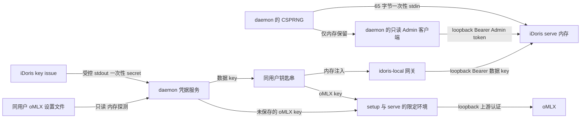

# Agent24 一站式 iDoris 启动器设计

状态：已评审（PR-Daemon 内容无阻塞），已并入 iDoris#588/#594 的冻结答复与 M-IDL1 范围裁决。**正文与 §13.1 冲突时以 §13.1 为准**；正文中「待冻结 / 待决」的条目，凡 §13.1 已给出答案的均视为已决。日期：2026-10-28。仅设计，不宣称功能已经实现。 基线：Agent24 `025dc3ad2efc7812e7754c7ffa8cae9481132b9f`。文内 Agent24 行号均指该提交。

## 1. 依据、目标与边界

跨仓事实来自 [iDoris#588](https://github.com/iDoris-ai/iDoris/issues/588)，本次读取正文及评论，评论为空。下文用 `#588 §1「小节」第 N 条` 标识正文条目，用 `#588 L1` 至 `L7` 标识 §2 的缺口编号。iDoris 仓库的源码出处以该 issue 中已核实的 path:line 为准，不把未来接口写成当前事实。 目标是在桌面 Models 页与 CLI 完成检测、下载、校验、安装、oMLX 配置、签发 key、启动、连接及真实对话验证。本文按 L1–L5 已交付后的形态设计，实际开放功能前必须锁定包含这些能力的正式版本并逐项验收。 本文没有引用出处的行为、字段、超时和默认值均为 Agent24 的设计建议，尚未实施。标为“待决”的上游契约不能由实现者猜测。

已有依据如下，后文方括号引用这些编号。

| 编号 | Agent24 事实与出处 |
| --- | --- |
| A1 | 规范指针、v0.3.2 资产及契约基线、已有网关和手动预算状态：`docs/iDoris-consumer.md:3`、`:9`、`:13` 至 `:19`。历史验收与本文目标版本分开。 |
| A2 | 原计划仅允许手动双进程，不托管 iDoris：`docs/agent/PLAN-IDORIS-V031.md:33` 至 `:40`；Agent24 不写 YAML 的边界见 #588 §1「oMLX 卡」第 4 条。 |
| A3 | 桌面与 CLI 共用业务逻辑、完整真实用例、每片规模和安全评审门槛：`AGENTS.md:20` 至 `:27`、`:53`。 |
| A4 | 预算只从 usable 扣显式 core 预留，零值有效：`rust/apps/agent24-cli/src/main.rs:1135` 至 `:1149`、`docs/agent/IDORIS-MANUAL-BUDGET.md:5` 至 `:20`。底层算法：`rust/crates/agent24-hw/src/budget.rs:120` 至 `:129`。 |
| A5 | 现有数据 key 来自环境；禁代理与重定向、限制 loopback，严格校验契约 1.0.1，简单和复杂请求映射 daily 与 deep：`rust/crates/agent24-models/src/idoris.rs:92` 至 `:117`、`:183` 至 `:201`、`:228` 至 `:244`。 |
| A6 | 网关独占、失败不回退：`rust/crates/agent24-models/src/router.rs:326` 至 `:330`、`:534` 至 `:539`、`:642` 至 `:655`。回执要求本地推理并保留真实模型：`rust/crates/agent24-models/src/idoris.rs:264` 至 `:310`。 |
| A7 | Desktop 的 FD 选择器、65 字节解析和直接读取 Admin：`apps/desktop/src/main/idoris-admin.ts:11` 至 `:21`、`:29` 至 `:37`、`:71` 至 `:102`、`:241` 至 `:276`。 |
| A8 | Hyphae 固定锁、只构造已校验对象、重验已有文件：`rust/crates/agent24-comm/hyphae.lock.json:1` 至 `:11`、`rust/crates/agent24-comm/src/binary.rs:126` 至 `:161`、`:175` 至 `:234`。 |
| A9 | 大组件不打包而按需下载；重定向逐跳限制 HTTPS 和主机：`apps/desktop/src/main/open-design-component.ts:1` 至 `:9`、`:38` 至 `:40`。 |
| A10 | 候选端口 8088、8000、8001：`apps/desktop/src/main/ipc/index.ts:33` 至 `:49`。真实认证配置在 `auth.api_key`：`docs/release/ACCEPTANCE-v0.6.0-preview.md:519` 至 `:527`。 |
| A11 | 整机账本和 LLM 推荐归属、档位及模型草案：`docs/design/HW-TIERS-capability-hardware-matrix.md:79` 至 `:116`、`:125` 至 `:137`。 |
| A12 | 钥匙串已有调用先例：`rust/crates/agent24-comm/src/password_store.rs:224` 至 `:242`、`:267` 至 `:283`；服务配置已禁止持久化 iDoris 数据 key：`rust/apps/agent24-cli/src/service.rs:128` 至 `:131`、`:510` 至 `:513`。 |
| A13 | OpenAPI 是 daemon HTTP 契约源，已有 Bearer 门禁：`protocol/openapi.yaml:1` 至 `:22`、`:40`；能力模式未知路由默认 Host 管理权限：`rust/apps/agent24d/src/server.rs:1029` 至 `:1049`。 |

本设计扩展旧计划的“Agent24 不启动 iDoris”边界。[A2] #588「背景」已经接受 launcher 与显式安装同意，但其“桌面端托管”是否包含 daemon 作为执行宿主仍需双方确认。后续计划和唯一规范须同步修订后再实施，不能用本文覆盖旧计划。[#588 §3] 非目标是安装 oMLX 本体、静默下载模型权重、管理云端或订阅后端、Intel 或 Linux 正式分发、远程 HTTP、可写 Admin API、动态预算协议及更改 iDoris 路由策略。iDoris 当前只发 Apple Silicon 资产，L7 维持此边界。[#588 §1「下载」第 2 条、L7] 按需下载原则沿用 [A9]：Agent24 安装包只携带锁和小型 UI。首次点安装时显示来源、版本、签名团队、下载大小和磁盘需求，由用户同意后下载；大小须来自发布清单，不编造数值。模型缺失时给出 oMLX 操作入口，另行同意模型下载。

## 2. L1–L5 是开放托管能力的前置

| 依赖 | iDoris 承诺的完成形态 | 本设计使用位置与仍需冻结的契约 |
| --- | --- | --- |
| L1 | SIGTERM 与 SIGINT 共用优雅停止路径，限时退出 | 日常停止、升级、卸载、重启；停止时限与收尾完成含义须明确。 |
| L2 | `idoris setup omlx --endpoint <url> [--bind <role>=<model>]…`，探测认证和模型，生成并校验组件目录，输出 JSON | 首次连接、端点或角色变化、升级重建；输出目录控制、JSON schema、失败码、凭据注入方式与幂等规则待冻结。Agent24 不写 YAML。 |
| L3 | `idoris key list` 与 `idoris key revoke <key_id>`，非交互 JSON | 轮换、吊销、失败补偿、卸载；返回结构、重复吊销及运行时并发语义待冻结。签发仍用现有 `key issue --spec-stdin`。 |
| L4 | 对 DB 独占锁；冲突快速退出，有明确错误码和文案 | start 与崩溃恢复；具体退出码尚未承诺，禁止把所有退出码 1 都当成已有实例。锁是 serve 生命周期锁还是会影响 key 子命令，须确认。 |
| L5 | `/health` 成为唯一就绪契约 | 所有启动和升级验证；冻结字段、版本格式及状态语义。可选 ready 行不参与判断。 |

**L6 已定、待随 v0.4.0 发版（iDoris 10-28 答复）**：自 v0.4.0 起 tar 内 `idoris` 用 `Developer ID Application: Huifeng Jiao (HYAP444FN9)` 签名（hardened runtime + timestamp）并经 `apple-notary-HYAP444FN9` 公证 Accepted 后才发版。launcher 只支持 v0.4.0 及以上的已签名版本，v0.3.x 不纳入托管。任何 L 的实现不能只看 tag 名，锁更新评审须附对应 release 说明与实际契约测试。[#588 §2、§3]

## 3. 由 agent24d 托管，外壳只调用 daemon

| 维度 | daemon 托管 | 桌面托管 |
| --- | --- | --- |
| CLI 与桌面一致性 | 一个安装器、凭据服务、监督器，所有外壳共用 | CLI 要依赖 Electron 常驻，或重复实现一套监督器 |
| 生命周期 | 以 agent24d 为准，关闭窗口不影响服务 | 跟随桌面退出，CLI 无法独立使用 |
| 凭据 | Admin 留在 daemon，数据 key 从钥匙串注入网关 | Admin 分散在桌面与 CLI 交接路径 |
| 代价 | 需新增 daemon 状态机、API 和关机协调 | 可沿用现有 Admin consumer，但还需另补 CLI 宿主 |

推荐 daemon 托管，符合共享业务逻辑要求。[A3] 拟在 Rust 增设 `agent24-idoris` 业务模块，负责锁解析、安装、setup、key 和子进程监督；`agent24d` 持有唯一实例，执行鉴权、生命周期与配置提交。模块不依赖 Electron，也不自行开 HTTP 服务。CLI、桌面主进程和未来 TUI 只访问 daemon API。 iDoris 负责 YAML、DB、key 策略、LLM 准入与路由；oMLX 负责推理与模型文件。Agent24 探测硬件、分配预算并展示推荐，不复制 iDoris 推荐器。[A11；#588 L2、§1「签发数据 key」] 拟将安装状态与运行状态分开保存。安装状态为未安装、下载中、校验中、已安装或失败；运行状态为停止、后端未就绪、配置中、启动中、就绪、等待重启或故障。另存连接验证结果，避免把 `/health` 成功显示成“对话可用”。 同一用户同一托管实例的变更由 daemon 串行执行，跨 daemon 用本机操作锁保护安装和配置。L4 负责服务 DB 实例冲突，不能代替 Agent24 的安装锁。重复 start 返回当前状态，重复 stop 成功；并发相反操作返回 `operation_in_progress`，不启动第二个子进程。

## 4. 桌面与 CLI 的用户流程

### 4.1 首次桌面安装与连接

1. 用户进入 Models 页的 iDoris 卡片。daemon 检测平台、已有安装、可用磁盘、托管状态及端口；卡片展示“安装并连接”。不扫描或接管用户自己的 iDoris 数据库。
2. 用户同意下载后，daemon 下载锁定资产、校验、安装。卡片显示阶段、字节进度与可重试错误。取消不改当前版本，不留下可执行的半成品。
3. daemon 探测 oMLX 端口及认证需求，从同用户钥匙串或设置文件获得 key。不可达则停在“等待 oMLX”；安装仍算完成，连接未完成。不会先启动 iDoris 再等待后端，因为当前版本会锁存 startup_error。[#588 §1「运行」第 5 条]
4. 用户确认实际模型与角色后，daemon 调 L2 setup，只接受成功且验证过的组件目录。缺模型则提示去 oMLX 准备模型并重试，不生成伪造绑定。[L2]
5. daemon 使用托管 DB 路径调用 `idoris key issue --spec-stdin`，将一次性 secret 写入钥匙串，保存非敏感 key_id。若钥匙串失败，吊销刚签发的 key，不进入“已连接”。[L3 用于补偿；#588 §1「签发数据 key」]
6. daemon 生成 Admin token，启动前台子进程并交接 stdin。轮询 `/health`，核对身份、锁定版本与契约，确认子进程存活；随后用 Admin token 校验管理面，避免误认被抢占的数据端口。[L4、L5]
7. daemon 原子提交 Agent24 非敏感配置：URL、安装版本、组件目录、key 引用、角色和生命周期策略；更新内存中的 idoris-local 网关。之前的配置快照保留至验证完成。[A5、A6]
8. 用户点“发送测试消息”，经 Agent24 正常 chat 路径验证。显示真实模型、Record-Id 与 locality=loopback 后才标“已连接”。失败保留“已运行，连接待验证”，允许重试或恢复之前配置，不自动改走云端。[A6]

### 4.2 首次 CLI 与桌面使用同一条流水线

以下均为拟新增命令。CLI 先连接或按现有宿主方式启动 agent24d，再请求相同 API；不在 CLI 自己 spawn iDoris。交互安装展示与桌面一致的确认，非交互模式必须显式 `--yes` 接受锁定版本与对应风险提示。

```sh
agent24 idoris status
agent24 idoris install
agent24 idoris connect --omlx-url http://127.0.0.1:8088 --bind "daily=实际模型ID"
agent24 idoris start
agent24 idoris stop
```

`install` 只完成下载至安装；`connect` 编排探测、L2 setup、签发 key、必要的 start、就绪校验与配置提交，最后提示用正常 chat 发送验证消息。桌面“安装并连接”组合这两步并进入测试消息页。`start` 在首次未配置时明确提示先 connect，已运行时不重启。 CLI 的 `status --json` 与桌面读取同一状态，包含安装版本、阶段、数据端口、预算字节、角色、连接验证状态和脱敏错误。退出码拟定为成功 0、操作失败 1、需用户补充配置 2；L4 上游退出码通过映射处理，不直接作为 CLI 退出码。

### 4.3 日常、升级与卸载

建议默认“随 agent24d 启停”，首次确认时显式显示，最终默认值待 jason 决定。桌面关窗与停止 daemon 分开；如果 agent24d 作为用户服务常驻，桌面退出后 iDoris 继续运行。显式 stop 设置暂停意图，自动监督器不能立即将其拉起；下次自动启动的恢复规则也随该策略确认。 “独立运行”分两种：保留 agent24d 用户服务，只独立于外壳运行；或者连接用户自行维护的外部 iDoris。后者只保存 URL 与钥匙串 key 引用，不承诺 Admin 概览、不托管启停、不升级卸载其文件。不提供无人托管的 detached 子进程模式。两种模式互斥，切换先停止自己的实例，不杀外部进程。 升级时提示版本与停机影响，用户确认后执行第 5 节事务。端点、oMLX key 或预算变化需要重启，不承诺热更新。[#588 §1「oMLX 卡」第 5 条；A4] 拟新增 `agent24 idoris upgrade`、`uninstall`、`keys list|rotate|revoke`，桌面提供对应按钮。卸载先断开新请求、吊销本实例 key、停服务、清除配置引用和钥匙串条目，再删除托管版本与缓存。[L1、L3]
默认保留 DB、日志和用户设置，显示保留位置。只有用户明确选择“同时删除 iDoris 数据”才删除托管 DB、状态及备份，绝不删除 `~/.omlx`、模型权重或外部 iDoris。吊销或停止失败须显示未完成项，允许继续清理，不提前报告卸载成功。

## 5. 版本锁、下载与安装事务

拟新增仓库文件 `rust/crates/agent24-idoris/idoris.lock.json`，编译时嵌入，随 Agent24 审核发布。借鉴 [A8] 的“校验后才可执行”边界，但锁的是归档而非 Hyphae 裸二进制。

| 锁字段 | 含义与约束 |
| --- | --- |
| `schema`、`tag` | 锁格式版本、精确发布 tag；不用 latest、分支或浮动 URL。 |
| `commit` | 精确发布 tag 对应的完整 Git commit。 |
| `assets.aarch64-apple-darwin.name`、`sha256` | `idoris-v<ver>-aarch64-apple-darwin.tar.gz` 和 64 位 SHA-256。平台无记录即不支持。 |
| `assets.<triple>.files` | 归档内允许的文件清单；非空，相对路径，不含 `..`，不得重复。 |
| `contract_major`、`min_contract_minor`、`tested_contract_version` | 允许的契约主版本、最低 minor 和实际验过的完整版本。主版本不同或 minor 低于最低值拒绝；同主版本仍须通过冻结字段及安全语义检查。 |
| `capabilities` | 已验收的 L1–L6 能力标识及发布说明来源；不通过运行未知参数来猜测。 |
| `team_id` | 签名团队 `HYAP444FN9`；安装时 `codesign` 校验必须一致（L6）。 |
| `release_url_base` | 官方 HTTPS Release 地址基址，主机须为 `github.com`；资产 URL 由基址、tag 和资产名派生。 |

注：首份锁已随 IL-01 落地（v0.4.0，sha256 `ab46e0180090ef5143b8fb6ea98b0333f2ef9c3a137bab2dc3cf7307960476d5`，team_id `HYAP444FN9`）。

当前资产名、每资产一个 `.sha256`、已发布 tag 与资产不可变来自 #588 §1「下载」第 1、4 条。v0.3.2 只作为历史基线 [A1]，不能填进声称满足 L1–L5 的首份锁。目标 tag、hash、完整契约版本待 iDoris 发版后填入，不预造。
下载器只接受从锁的 tag 派生的官方 HTTPS Release 资产，重定向逐跳核对官方资产主机白名单；设置连接、总时长和大小上限，失败可重试。`.sha256` 仅供发布核对，最终必须匹配 Agent24 内置锁；不能用同次下载的校验文件替换锁。续传文件也必须重算完整 hash。[A9]
目标根为 `~/Library/Application Support/Agent24/idoris/`，版本目录 `<ver>/` 只含那一版的已验证二进制与原始 config。共享可变数据放在 `data/`，包括 DB、绝对路径的 state；L2 生成目录放在 `instances/<实例ID>/components/<配置代次>/`，与不可变发行文件分开。[安装位置和五文件布局：#588 §1「安装布局」第 1 至 4 条]
安装事务拟按以下顺序完成。

1. 在目标同一文件系统创建私有随机 staging 目录，根与数据目录权限 0700，数据文件 0600。持有操作锁，检查压缩包和解包空间，空间未知时拒绝新安装。
2. 将归档下载为不可执行 `.part`，验证 SHA-256 后交给受限安装子进程。解包前校验目录项，仅允许发行约定的五个普通文件和父目录；拒绝绝对路径、`..`、软硬链接、重复路径及超出限额的解压内容。
3. 安装子进程在自身 exec 之后才打开可执行文件的写句柄，写入、校验、同步并关闭所有句柄，然后退出。父进程等待成功退出，重读校验清单，设置二进制 0500、原始配置只读，再 rename 整个 staging 到 `<ver>/`，同步父目录。
4. 父进程不以可写方式打开将执行的 inode。安装子进程不再派生后台进程，不继承凭据。只有安装完成记录和文件验证均成功才产生可运行对象；已有目录必须重验，不覆盖运行中的二进制，也不因路径存在就信任。

该子进程方案专门避开 [Agent24#1429 正文及协调者评论](https://github.com/iDoris-ai/Agent24/pull/1429) 记录的窗口：多线程父进程写 fd 会被并行 fork 的子进程继承，父进程 drop 后仍可能 ETXTBSY。rename 不改变 inode，单纯 sleep、重试或“写后 close”不能证明消除窗口。本设计不直接复用 [A8] 的写文件实现，只沿用校验边界。
**纵深校验（L6，随 v0.4.0 生效）**：sha256 与锁一致之后，安装子进程再对解包出的 `idoris` 执行 `codesign --verify --strict -R '=anchor apple generic and certificate leaf[subject.OU] = "HYAP444FN9"'`（用 designated requirement 强制团队，而不是解析静默通过的输出），并解析 `codesign -dv` 的 `TeamIdentifier=` 行与锁里固定的 `team_id` 交叉核对；任一不符即拒绝安装。具体 requirement 写法在 IL-03 用真实 v0.4.0 二进制实测后冻结。程序下载的文件本身不带 `com.apple.quarantine`，所以不存在去除隔离属性的问题；本设计不运行 `xattr -dr`、不关闭 Gatekeeper。裸 Mach-O 不能 staple，首次运行时系统会联网核验公证票据，离线首跑可能被拦，这一条写进失败模式。hash 证明字节与 Agent24 审核过的一致，签名证明来源是同一开发者团队；发布账号或签名私钥失陷仍是剩余风险。[#588 L6；iDoris 10-28 答复]
升级事务为“下载新版本 → 安装校验 → 停止旧服务 [L1] → 关闭 DB 后做一致备份 → L2 生成新组件目录 → 新版本启动 [L4、L5] → 测试对话 → 提交活动版本”。备份包含 DB、相关 SQLite 文件、配置与 key 引用；真实请求在切换期间暂停，禁止双版本同时打开同一 DB。
新版本失败时先停新服务，再恢复旧二进制、旧组件、DB 快照与对应 key 引用。恢复前展示会丢弃哪些升级验证数据；放行真实流量后不自动回滚 DB。iDoris 尚未承诺迁移兼容性，不能只换二进制就宣称可回滚；兼容矩阵与备份恢复验证是升级开放前置，未明确时只允许保持当前版本。

## 6. 子进程运行与监督

启动固定使用验证后的绝对路径，参数仅为 `serve --admin-token-stdin`。daemon 用 CSPRNG 生成 32 随机字节，编码成 64 位小写 hex，再追加 `\n`，恰好 65 字节。spawn 后立即写入一次性 stdin 管道，必须在 iDoris 的 10 秒期限内写完并关闭；失败就停止本次启动，不能降级成无 Admin。[#588 §1「运行」第 1 条、「Admin token 交接」第 1 至 3 条]
Admin token 仅在 daemon 和 iDoris 内存驻留，每次启动重建，不进 argv、环境、钥匙串、临时文件或日志。这是一次性运行凭据的明确例外；需要跨重启保存的数据 key 与 oMLX key 使用钥匙串。iDoris Admin Bearer 只访问只读 GET，签发 key 不走 Admin。[#588 §1「Admin token 交接」第 3、4 条]
子进程先 `env_clear`，只注入必要的系统白名单和下表。setup、key 子命令也按各自需要单独构建环境，不把所有父进程环境原样传递。

| 环境变量 | 托管值与来源 |
| --- | --- |
| `IDORIS_COMPONENTS_DIR` | L2 返回并校验的绝对组件目录；目录必须在托管实例根内，无凭据。 |
| `IDORIS_DB_PATH`、`IDORIS_STATE_DIR` | `data/idoris.sqlite3`、`data/state/` 的绝对路径；serve 与所有 key 命令共用同一 DB。 |
| `IDORIS_CATALOG`、`IDORIS_ROUTING_POLICY` | 指向当前验证版本的原始 config 文件，避免意外继承外部配置。 |
| `IDORIS_ALLOCATED_BUDGET_BYTES` | 复用 `hw idoris-env` 的底层预算逻辑，从实时 usable 扣已记录的 core 分配；保留真零，不重复扣 OS。不能自动取 core=0。[A4] |
| `IDORIS_OMLX_API_KEY` | 同用户钥匙串，或设置文件探测后仅在内存中的 key；只给 setup 和 serve，不给 key 命令与安装器。 |
| `IDORIS_PORT`、`IDORIS_ADMIN_PORT` | 默认 8740、8741；冲突后用户可选空闲端口，配置与 URL 一起更新。 |
| `IDORIS_BIND_HOST`、`IDORIS_DEPLOY_MODE` | 强制 `127.0.0.1`、`personal`。不继承 Tenant、Tailscale、开发无 key 或订阅开关。 |

变量及默认值依据 #588 附录；state 必须绝对路径依据 §1「安装布局」第 4 条。v0.4.0 起 iDoris 自身还留 1GB 余量，不由 Agent24 再扣一次。[#588 §1「其它约束」第 2 条]
就绪建议每 250ms 轮询一次数据面 `/health`，单次 2 秒、总计 30 秒上限，要求 status=ok、service=idoris、version 匹配锁的版本、contract 主版本可接受、instance_id 非空、dev_no_key_enabled=false，并持续检查子进程未退出。字段最终以 L5 为准，不解析 stdout，不把 TCP 连通视为就绪。[L5；#588 §1「运行」第 4 条；A5]
网关的契约检查已由 #1435（合入 main，#1439）放宽为「major 为 1 且 ≥1.0.1」；launcher 的就绪校验复用同一检查，并按 §13.1 的 L5 规则要求 minor 不低于所需能力对应的版本。 实施时将兼容策略作为共享的已审核契约校验：保留身份、禁 dev、字段和 locality 检查；同主版本可接受范围由目标版本契约测试证实。L5 缺字段或未知主版本均失败关闭。
停止时先阻止新推理请求，等待进行中请求完成或取消，再向自己持有的子进程组发 SIGTERM，建议等 17 秒（见 13.1），超时 SIGKILL 并 wait 回收，记录是否被强杀。最终宽限期须覆盖 L1 承诺的收尾时限。关停 agent24d 时预算必须包含此阶段，不能先让宿主退出。[L1]
L4 冲突映射为“同一数据库已有实例”，不改端口绕过、不自动杀进程。预检端口不能消除竞争；启动失败时按 L4 冻结错误码区分 DB 锁与普通 bind 错误。已有外部实例必须由用户改用外部连接模式。[L4；#588 §1「运行」第 2 条]
崩溃重启建议在 5 分钟内最多 3 次，延迟 1、2、4 秒，每次重新探测 oMLX、读取预算并生成 Admin token；连续稳定 5 分钟才清零计数。鉴权、配置、锁冲突、预算和契约错误不自动重启；收到用户 stop 或关停意图也不重启。
daemon 自身异常退出后，重新启动时先核对非敏感运行记录中的 PID、启动时间、可执行路径和用户身份。若确认是遗留托管进程，停止并重启，重新建立 Admin 交接；不能恢复旧 token。身份不能确认或无法安全停止时显示 L4 冲突，交给用户处理，不按 PID 文件盲杀。
日志拟写 `~/Library/Logs/Agent24/idoris/`，仅同用户读取，每份 10MiB、保留 5 份。stdout/stderr 有界消费，轮转不阻塞进程。默认只记录阶段、退出码与受控错误类别，不落原始 key 子命令 stdout、setup 响应、HTTP body、请求头或聊天内容；诊断子进程输出先脱敏再写盘。仅匹配 `idk_` 不够，已知 token 与上游 key 也须剔除。

## 7. 数据 key、配置与 Admin 迁移

签发固定走 `idoris key issue --spec-stdin`，stdin JSON 使用 owner=`agent24`、allowed_privacy=`["local_only"]`，默认 allowed_roles=`["daily"]`；只有用户启用并成功绑定 deep 时才增为 `["daily","deep"]`，不用通配、全角色或具体模型覆盖授权。Personal 不设置 tenant_id，过期策略待决。[#588 §1「签发数据 key」第 1 条]
现有复杂请求会选 `idoris/deep`。[A5] 默认仅 daily 时须在 UI 标明“深度能力未启用”，复杂调用可能得到角色拒绝，不能靠扩大 key 权限或回退 provider 掩盖。是否首次同时绑定 deep 由 jason 与 iDoris 决定，见第 13 节。
签发命令在受限管道返回 key_id 与一次性 `idk_` secret，限制输出大小、超时及 JSON 字段；立即把 secret 存进钥匙串，业务配置只存稳定引用。钥匙串命名暂不定案，不能挪用 Hyphae 的 service/account；实现可参考 [A12] 的异步封装，但不依赖 COMM 业务类型。
连接使用非敏感 `IDORIS_URL` 与数据 key，继续走 idoris-local 网关并保留无回退语义。[A5、A6] 托管路径需新增显式内存凭据构造入口，daemon 从钥匙串取 secret 直接传给网关，避免运行中修改全局环境；手动环境输入在边界读取后也调用同一校验。服务启动只保存 key 引用，不往 plist 写 `IDORIS_API_KEY`，也不复用可能落盘的 `OMLX_API_KEY` 透传通道。[A12；`rust/apps/agent24-cli/src/service.rs:132` 至 `:133`]
配置提交先构造并验证新网关，再原子切换内存快照；并发旧请求只持有旧快照。钥匙串无法访问时显示“请解锁钥匙串”，不回退明文配置、固定内置 key 或无 key 模式。
轮换流程为“签发最小权限新 key → 钥匙串暂存 → 新 key 真实请求验证 → 切换引用与网关 → 等旧请求完成或取消 → revoke 旧 key → 删除旧钥匙串条目”。失败时保留可用旧 key 并吊销新 key；旧 key 吊销失败显示“新 key 已生效，旧 key 待吊销”，持久保存待处理 key_id，不在重试时重复签发。[L3]
跨崩溃补偿用非敏感操作记录与 L3 list 对账，key_id 是删除和吊销依据，禁止只凭 owner=`agent24` 批量吊销，避免影响其他实例。签发成功但结果未收到的归属识别仍需 L3 schema 与操作关联机制支持，未解决前将列为待清理授权，不宣称事务完全成功。
L4 与 L3 的并发关系尚不明确。设计不要求 key 子命令绕过 serve 锁：若不支持在线 key 操作，则暂停请求、按 L1 停 serve、执行 key 子命令后再启动。在线无停机轮换只有在 iDoris 明确支持并完成测试后才开放。[L1、L3、L4]
`idoris-admin.ts` 的 TOKEN_ARG 是桌面侧 FD 选择器，绝不是 iDoris 参数；两者不是把字符串替换一下就能互通。[A7；#588 §1「Admin token 交接」第 1 条] 迁移后由 daemon 持有 Admin token 并查询只读 Admin，桌面 consumer 改为 daemon 状态适配器；移除旧 FD 读取和启动交接调用点，不传 `--idoris-admin-token-fd` 给 iDoris，也不向桌面转发 token。CLI 复用同一投影结果。

## 8. oMLX 探测与角色模型选择

端点优先使用本实例已确认的 URL，其次尝试 `http://127.0.0.1:8088`、`:8000`、`:8001`，来源见 [A10]。探测是有界 HTTP 请求，不扫描全网，不把任意 OpenAI 兼容服务都自动认作 oMLX；多个候选可达时请用户选择。产品可输入其它端口，但地址必须是经过解析的 loopback IP，不接受 URL 用户信息、路径、query、fragment 或重定向。
先做无 key 探测，401 或 403 显示“需要认证”，不能当作“没有模型”。有钥匙串引用时只对对应已确认端点试 key；否则同用户读取 `~/.omlx/settings.json` 的 `auth.api_key`，来源是 [A10]。文件不存在、解析错误和 key 错误分别报告，禁止猜默认 key。
读取由 daemon 在有效用户身份下完成，检查文件及父目录归属与权限、拒绝符号链接，限制读取大小；使用打开后的元数据核验，避免先检查后替换。只读该字段且只在内存中，不改写 settings.json，不写日志。自动发现的 key 不自动持久化；用户选择“保存连接凭据”后才写钥匙串，之后优先钥匙串。禁止向尚未确认身份的其它候选端口广播同一 key。
Agent24 的探测用于 UI 选择，最终由 L2 再确认可达、认证、模型列表及组件合法性。拟通过 `IDORIS_OMLX_API_KEY` 环境交给 setup，不新增 argv key；该输入是否被 L2 支持须冻结。L2 返回路径必须验证在托管根中；输出路径、错误 schema 或目录命名未定前不猜参数，也不退回 Agent24 写 YAML。[L2；#588 §1「oMLX 卡」第 4、5 条]
`--bind role=model` 中左边是 daily 或 deep，右边必须是探测到的真实模型 ID。建议按下表给候选，最终选择交给 iDoris 预算准入与用户确认，不用模型名字符串替代容量判断。[A11]

| HW-TIERS 档位 | daily 候选建议 | deep 处理 |
| --- | --- | --- |
| 1 档与 2 档 | 默认不自动启用本地 LLM；2 档只展示用户已有、准入允许的小模型 | 不自动绑定；本文不自动开启云端。 |
| 3 档，16GB 或 18GB | 优先展示已安装 Qwen3.5-4B Q4 对应实际 ID | 默认关闭。 |
| 4 档与 5 档，24GB 至 48GB | 优先展示 Qwen3.5-9B Q4 对应实际 ID | 不能按档位直接启用；32GB、36GB 不承诺放下 27B，48GB 也须确认驱逐策略。 |
| 6 档，64GB 以上 | 展示 9B Q8 或 iDoris 推荐的已有模型 | 可建议 35B-A3B，但仍需实际预算、模型与用户选择。 |

这些是 [A11] 的草案候选，不是冻结的产品默认值；缺推荐接口或模型目录映射时展示实际列表供选，不能取 `/v1/models` 第一项。`_degradation` 与 on_demand 卡由 L2 负责，不由 Agent24 拼写。预算无来源或准入不通过时保持未连接，不静默把 core 预留改成零。

## 9. daemon API、CLI 与桌面契约

以下为拟新增路由，实施时先写进 `protocol/openapi.yaml`，生成类型并加契约夹具，不能只在 Electron IPC 私加能力。[A13] 所有路由使用 daemon 的认证与 Host 管理权限；能力模式拒绝 Creative、模块和远端调用者，legacy 模式沿用宿主门禁。桌面主进程代理固定方法，renderer 不拿 Admin token 或任意代理能力。

| 方法与路径 | 请求及结果 |
| --- | --- |
| `GET /api/v1/idoris/status` | 安装和运行状态、版本、契约、预算、端口、角色、脱敏 Admin 概览、连接验证结果、当前操作与恢复动作；不返回 secret。 |
| `POST /api/v1/idoris/install` | 已展示版本与风险的同意记录；只安装内置锁版本。返回 202 和 operation_id。 |
| `POST /api/v1/idoris/connect` | 模式、loopback 端点、角色绑定与凭据引用；负责 setup 到配置提交。返回操作标识。 |
| `POST /api/v1/idoris/start`、`stop` | 使用已保存配置启动或停止，不允许调用者注入任意 argv、env 或文件路径。 |
| `GET /api/v1/idoris/keys` | 仅本实例的 key 元数据。[L3] |
| `POST /api/v1/idoris/keys/rotate`、`POST /api/v1/idoris/keys/{key_id}/revoke` | 轮换或吊销本实例 key；吊销活动 key 后立即断开网关。[L3] |
| `POST /api/v1/idoris/upgrade`、`uninstall` | 只升级到审核锁；卸载请求明确是否删除数据。 |
| `GET /api/v1/idoris/operations/{id}`、`POST /api/v1/idoris/operations/{id}/cancel` | 查询阶段、进度、结构化错误及可取消性；进入不可中断提交阶段后拒绝取消。 |
| `POST /api/v1/idoris/credentials/omlx` | 显式手工补录的 key 只由主进程或 CLI 隐藏输入送入 daemon，立即入钥匙串，只回引用；请求体和回显禁日志。自动读取设置文件无需该路由。 |

变更请求带幂等标识，操作状态落盘只含非敏感字段。长任务断开 HTTP 后继续，重连用 operation_id 查询；重复请求复用结果。统一错误包括 code、中文 message、retryable、next_action，明确 401 未鉴权、403 非宿主、409 冲突、422 配置不符、502 下载或上游错误、503 钥匙串或后端未就绪；具体 schema 在第一片冻结。
CLI 至少提供 `agent24 idoris install|start|stop|status|connect`，另提供升级、卸载及 key 操作；支持 `--json` 与进度输出，不接受明文 `--api-key`。手工输入用隐藏终端或受控 stdin，不能打印一次性 secret。每项桌面业务操作都有 CLI 入口。[A3]
Models 页的 iDoris 卡片展示版本、安装进度、oMLX 与模型、实际预算、运行和连接状态；按钮随状态给出安装、继续配置、启动、停止、验证、升级、卸载。高级区提供端口、生命周期、key 元数据和日志入口。Admin 数据沿用只读投影，不做可写 Admin。[A7；#588 §1「Admin token 交接」第 4 条]

## 10. 凭据流向与安全边界



Admin token 的生成和禁止持久化来自 #588 §1「Admin token 交接」；数据 key 一次性输出来自「签发数据 key」；oMLX 输入环境来自「oMLX 卡」第 5 条；图中钥匙串、共享凭据服务及内存注入为本文方案。[A12] Agent24 自身的 daemon 客户端认证沿用现有机制 [A13]，与这三种 iDoris 凭据分离，不互相替代。
所有进程以当前用户权限运行，不用 sudo，不安装系统服务。HTTP 数据面、Admin、oMLX 与外壳到 daemon 都只走 loopback，禁代理、禁重定向；本功能收紧 #588 附录允许 Tailscale 的范围。下载是独立的 HTTPS 出站路径，不带本机凭据。

| 威胁 | 缓解与剩余风险 |
| --- | --- |
| 下载被替换或锁被篡改 | 内置审核锁、完整 hash、主机白名单、未校验不可执行；L6 前缺开发者身份认证，发布账号或 Agent24 供应链失陷仍有风险。 |
| 恶意归档、解包越界或同名替换 | 文件白名单、禁止链接、大小限制、私有 staging、重验已装内容、不可变版本目录；同用户恶意进程仍在信任边界内。 |
| 恶意本地进程占端口骗取 key | 端口冲突不接管、L4、健康加带 token 的 Admin 检查；oMLX key 只给确认的端点。loopback 不提供进程身份认证，残余风险须说明。 |
| 凭据泄露到子进程或外壳 | 分命令环境白名单、管道交接、敏感类型与日志脱敏；oMLX key 必须进 serve 环境是上游现行限制，同用户进程可见性的风险不能靠钥匙串消除。 |
| 未授权安装、停止或吊销 | 所有路由鉴权、Host 权限、同意记录、实例归属检查、固定可执行文件与参数；不得向模块开放通用执行代理。 |
| 崩溃、半安装与双实例 | 原子提交、非敏感操作记录、幂等恢复、L4 和有界重启；无法确认遗留进程身份时要求人工处理。 |
| 数据误删或错误回滚 | 默认保留数据、二次明确清除选项、仅处理托管根、升级前离线备份；schema 不明确时禁止自动升级。 |

## 11. 失败模式与恢复

下表错误码均为拟定的 Agent24 分类，不冒充尚未冻结的 iDoris 退出码。

| 场景 | 用户看到什么 | 可以做什么及系统行为 |
| --- | --- | --- |
| 网络超时、下载中断 | “下载未完成”，显示重试 | 重试或取消；有效缓存只在完整 hash 通过后使用，当前安装不变。 |
| hash 不符 | “下载校验失败，未安装” | 删除不可信缓存并重新下载或报障；不得跳过校验。 |
| 未支持平台 | “此组件需要 Apple Silicon Mac” | 保持原模型配置；不下载其它平台资产。[L7] |
| 解包非法、磁盘满或权限不足 | “安装失败”，给出目标卷和空间或权限原因 | 释放空间、修复用户目录权限并重试；清理 staging，不碰活动版本。 |
| 签名校验失败或首次运行公证核验失败（离线） | “签名校验未通过”或“首次运行需要联网核验” | 签名不符直接拒绝安装并报障；离线首跑提示联网后重试；不移除任何系统保护。[L6] |
| 8740 或 8741 被占用 | “iDoris 端口已被占用” | 释放端口或选其它端口重启；不发送凭据给占用者，不杀未知进程。 |
| oMLX 不可达、没有模型 | “等待 oMLX”或“请准备本地模型” | 启动 oMLX 或准备模型后重新探测；不启动会锁存错误的 iDoris。[L2] |
| oMLX 认证失败 | “oMLX 认证失败，请更新上游凭据” | 重新读取设置或安全补录；不误提示轮换 iDoris 数据 key。现有 `upstream_auth_failed` 处理见 `rust/crates/agent24-models/src/idoris.rs:146` 至 `:159`。 |
| setup 失败或 schema 未知 | “组件配置失败”，指出可操作字段 | 修正模型、端点或升级匹配版本；不写 YAML 兜底，不签发无用 key。[L2] |
| 钥匙串锁定、拒绝访问 | “请解锁钥匙串或允许 Agent24 访问” | 解锁后重试；不存明文。新签发 key 尽力吊销并记录未完成补偿。[L3] |
| L4 锁冲突 | “同一数据库已有 iDoris 实例” | 由用户停止外部实例或选择外部连接；不自动重启循环。[L4] |
| 健康超时、版本或契约不符 | “启动未通过就绪校验” | 停止自己的子进程；重试、恢复原配置或选择已审核版本。[L5] |
| 预算不足或 core 预留未知 | “本地预算不足”或“缺少整机分配” | 调整已有能力或选择更小模型；不省略预算、伪造 RAM 或改用云端。[A4、A11] |
| 数据 key 401、角色 403 | “连接凭据失效”或“未启用此角色” | 分别轮换 key 或显式启用角色；不默认发全权限 key。[A5；L3] |
| 停止超时、进程反复崩溃 | “已强制停止”或“自动重启已暂停” | 查看脱敏日志并手动重试；崩溃达到上限后保持故障。[L1] |
| 升级或卸载中断、吊销失败 | “操作未完成”，列出残留项 | 按 operation_id 继续或恢复；不隐藏未撤销授权，不删除外部数据。[L1–L4] |

## 12. 测试与真实用户验收

实现前先写行为失败用例，再修复并记录反面对照。[A3；`AGENTS.md:68`] 单测覆盖锁字段、平台与契约匹配、预算真零、token 恰好 65 字节、角色最小范围、归档越界、状态转换、幂等补偿及重启上限；测试不访问真实登录钥匙串。
集成测试用可控假 iDoris 可执行文件与本机 HTTP fixture，真正经 daemon API 和 CLI 操作，捕获参数、限定环境及 stdin。覆盖 token 延迟或断管、健康慢或错误版本、Admin 验证失败、认证拒绝、L4 冲突、SIGTERM 收尾与超时 SIGKILL、恶意输出脱敏、轮换中断、服务模式重启后读 key、卸载保留数据。假 setup 必须证明 Agent24 没写 YAML。
下载测试用隔离的 HTTPS fixture 与测试专用锁注入，验证错误 hash、跨主机重定向、断网、解压炸弹、磁盘满、已有目录被篡改及原子切换前崩溃。测试锁不能成为发布版覆盖开关。并行安装与 spawn 在 Linux CI 验证无可写可执行 inode 继承，macOS 成功不能证明 ETXTBSY 已解决。[Agent24#1429]
真机按 [ID-8 风格](../release/ACCEPTANCE-v0.6.0-preview.md) 执行，依据 `:517` 至 `:528`：只在 jason 笔记本，全新数据目录或新 macOS 用户，实际锁定归档与真实 oMLX、已有小模型。不要改写操作者的 HOME；用显式数据目录或隔离子进程环境。测试钥匙串使用独立命名空间并清理，自动发现设置文件仅在操作者同意的真实用户环境中验证。

| 用例 | 操作与用户可见判据 |
| --- | --- |
| IL-1 首次桌面 | 点击安装并同意 → 完成下载、配置、签发、运行与测试消息；Models 显示真实模型、Record-Id、loopback，安装包没有大组件。 |
| IL-2 首次 CLI | 新数据目录运行 install、connect、status 与正常 chat；不启动桌面也能完成，重开桌面看到同一状态。 |
| IL-3 离线日常 | 安装完成后断网，重启 agent24d，key 从钥匙串恢复，真实模型答复成功；停 daemon 后子进程退出。[L1、L5] |
| IL-4 生命周期 | 关窗保留常驻服务、显式 stop 保持暂停、start 恢复；外部模式下 stop 不杀外部服务。 |
| IL-5 异常与权限 | 端口占用、上游 key 错、data key 失效、未授权角色、L4 冲突各出现对应提示；无直接 oMLX 或云回退。[L2–L4] |
| IL-6 升级恢复 | 已审核新版本升级成功；再注入启动失败，验证旧 DB 和 key 引用恢复且能真实对话；未知迁移版本拒绝升级。[L1、L2、L4、L5] |
| IL-7 凭据操作 | list 不泄 secret；轮换后新 key 可用、旧 key 被拒，吊销活动 key 后连接立即不可用。[L3] |
| IL-8 卸载 | 默认卸载保留 DB 与模型；明确清除只删托管数据；重复卸载无残留运行进程或活跃 key。[L1、L3] |
| IL-9 签名校验 | 正常包 `codesign` 校验通过、TeamIdentifier=HYAP444FN9；替换为未签名或其他团队签名的同名二进制时安装被拒；离线首跑给出联网核验提示。 |

每项保存 Agent24 提交、iDoris tag/hash、L1–L5 发布证据、命令、端口、预算、脱敏结果和 PASS/FAIL/SKIP。未跑的真机项明确标 SKIP，fixture 不代替真实推理；桌面纯展示另由人工确认。[A3] Rust 与前端门禁按 AGENTS 执行；改 protocol 额外跑 `pnpm lint:openapi`、`pnpm gen:api` 并核对生成文件无漂移。

## 13. 待决问题与责任人

| 裁决方 | 问题与未解决时的限制 |
| --- | --- |
| jason 与 iDoris | #588 的桌面宿主决定是否接受 agent24d 实际托管；更新唯一规范与执行计划后启动实施。 |
| iDoris | 冻结 L1 停止时限、L4 错误码及 key 命令与 serve 锁的并发语义；未明确前不宣称在线轮换。 |
| iDoris | 冻结 L2 目录控制、JSON、凭据输入、预算准入结果与错误码；Agent24 能否用环境传 key，如何保证输出只在托管根内？ |
| iDoris | L3 list/revoke schema、幂等与生效时间；签发结果丢失时如何准确关联本次 key，避免误撤其他实例？ |
| iDoris | L5 字段、version 格式、contract 次版本兼容策略；L1–L5 首个可消费 tag/hash 是什么？ |
| jason 与 iDoris | HW-TIERS 草案对应哪些真实模型 ID，是否默认同时绑定 deep，2 档是否只允许手动连接？未定前仅提供已探测列表与 daily 最小授权。 |
| jason | 是否默认随 agent24d 启停、显式 stop 跨重启是否保持、是否默认常驻用户服务；界面必须准确说明关窗与停止差别。 |
| jason 与安全负责人 | 钥匙串 service/account、共享用户服务的访问控制、data key 有效期及轮换周期；未定不发明命名规范。 |
| 已定 | L6：共用 HYAP444FN9，自 v0.4.0 签名并公证；launcher 不支持未签名的 v0.3.x。 |
| iDoris | 升级 schema 兼容矩阵、一致备份与恢复方法，DB 的 WAL 关闭保证；未明确前禁自动升级与无损回滚承诺。 |

### 13.1 iDoris 冻结答复（2026-10-28，[iDoris#588 评论](https://github.com/iDoris-ai/iDoris/issues/588#issuecomment-6460128833)）

| 条目 | 冻结结论 | 对本设计的影响 |
| --- | --- | --- |
| 托管宿主 | 接受 agent24d 作为执行宿主；iDoris 规范 v0.4.0 把「Agent24 不启动 iDoris」改为「agent24d 是执行宿主」，数据面规则不变 | §3 推荐方案成立，§13 第 1 行关闭 |
| L1 停止 | SIGTERM 与 SIGINT 都优雅停止，最多 10 秒；之后再用最多 5 秒回收本地 runtime 子进程组，总计约 15 秒（iDoris#594） | §6 停止：先发 SIGTERM，17 秒未退再 SIGKILL；停机超时 iDoris 会打印 `[idoris] 停止失败：…` |
| 退出码 | 0 正常；1 失败或超时；**3 = 同一 DB 已有实例**（L4）；实例锁按 canonical 路径计算，用符号链接别名打开同一个 DB 也算同一实例（#594） | §6/§11 的 L4 映射用退出码 3，其他非零不当作实例冲突 |
| key 子命令与实例锁 | issue/list/revoke 不受实例锁限制，服务运行中可用；revoke 立即生效 | §7 支持在线轮换，删除「先停 serve 再操作 key」的预案 |
| L2 setup | 只写 out-dir 及其同级的 `.idoris-setup-*` 临时目录；oMLX key **只从 stdin 读取**，不读环境变量；错误码 11 个（#594 新增 `write_failed`），已冻结；`--force` 全有或全无地替换 out-dir，替换前会复查目录，探测期间出现的外来文件不会被覆盖 | §5/§8：out-dir 放在托管根下一层；setup 的 key 改走 stdin，不用 `IDORIS_OMLX_API_KEY` 环境变量 |
| 签发结果丢失时的归属 | 每次签发用唯一 owner `agent24d:<install_id>:<nonce>`，丢失后按 owner 调 list 找到再 revoke | §7 补偿流程按此实现；owner 不再固定为 `agent24` |
| L5 就绪 | 只看 /health；兼容规则：major 必须为 1，minor 不低于所需能力对应的版本 | §6 就绪校验和 #1435 的契约检查保持一致；锁里记录所需的最低 minor |
| 模型默认 | 不做静态分档；最少只绑 daily，是否绑 deep 由用户选择 | §8 的分档表降为候选展示，不作为默认绑定 |
| 升级、备份、WAL | 放到 M-IDL2 再定 | 与 §14.1 一致 |

iDoris 侧 PR：#586（capabilities）、#587（运行时 headroom）、#589（key list/revoke）、#590（setup omlx）、#591（SIGTERM 与实例锁）。全部合入后发布 v0.4.0（签名并公证）。IL-01 等 v0.4.0 发布后再开工，锁里填入它的 tag 和 sha256。

### 13.2 iDoris v0.4.0 行为变化：余量确认（iDoris#597 评审转交）

设置了 `IDORIS_ALLOCATED_BUDGET_BYTES` 且额度紧张时，v0.4.0 起运行时也会保留 1GB 余量（以前只有推荐器保留）。因此**以前能直接加载的模型，现在可能返回 503 `headroom_confirmation_required`**。正确处理：先按 `reason_code` 分类，询问用户，用户确认后对这一次请求带上 `X-iDoris-Headroom-Breach: confirmed` 重发。不要当作普通的不可用去重试或换 provider。另外，503 `supervisor_busy` 表示同一模型正以不同的余量确认状态加载中，用同一个请求头稍后重试即可，不需要问用户。详细契约见 iDoris 规范修订 1.3 §2.7/§2.8，Agent24 侧实现登记为 ID-HR。launcher 按 §6 计算并传入的预算属于这种情形；IL-09（网关连接）和 IL-13（桌面卡片）的验收需要覆盖「额度紧 → 503 → 用户确认 → 重发成功」这条路径。

## 14. 按依赖顺序拆分实施

下列每片包含自己的行为测试，源代码、测试和手写契约合计最多 300 行；生成文件按仓库规则另计。达到上限继续拆片，不能用巨大框架预埋后续行为。所有安全、授权、数据写入和 wire 片等 PR-Daemon APPROVE。[A3]

| 顺序与任务 | 交付及片内验收 | 前置片与 L 依赖 |
| --- | --- | --- |
| IL-01 契约与锁 | 冻结跨仓问题，加入首份真实锁（含 team_id）与解析，拒绝未满足能力的版本 | 等 iDoris v0.4.0（含 L1–L6）发版后开工。 |
| IL-02 下载 | HTTPS、锁 hash、缓存与取消；错误 hash 不可进入安装 | 01；无新增 L。 |
| IL-03 安装 | 受限子进程解包、关闭写句柄后原子落盘，重验已有版本 | 02；无新增 L，覆盖 #1429。 |
| IL-04 oMLX 探测 | 端口、认证分类、同用户设置读取与安全输入 | 03；L2。 |
| IL-05 组件配置 | 调 setup、验证目录与绑定；预算复用 hw idoris-env 逻辑 | 04；L2。 |
| IL-06 数据凭据 | key issue、钥匙串存取、失败吊销及最小角色 | 05；L3、L4 并发约定。 |
| IL-07 启动就绪 | Admin stdin、环境白名单、共享契约校验与 health | 06；L4、L5。 |
| IL-08 停止恢复 | SIGTERM 时限、SIGKILL、有界重启、遗留进程安全处置 | 07；L1、L4。 |
| IL-09 网关连接 | 内存凭据入口、原子配置、服务重启恢复及首次真实 chat | 08；L5，保留现有安全证据。 |
| IL-10 生命周期 API | OpenAPI 的 status/start/stop、权限与操作查询 | 09；L1、L4、L5。 |
| IL-11 安装连接 API | install/connect/credentials、同意记录、幂等与取消契约 | 10；L2、L3。 |
| IL-12 CLI | install/start/stop/status/connect 与正常 chat 验证入口 | 11；继承 L1–L5。 |
| IL-13 桌面迁移 | Models 卡片与 daemon 投影，删除 TOKEN_ARG 旧交接路径 | 12；继承 L1–L5。 |
| IL-14 key 生命周期 | list/rotate/revoke 业务、API 与 CLI，验证旧 key 真失效 | 13；L1、L3、L4。 |
| IL-15 升级事务 | 离线备份、切换与失败恢复业务及 API、CLI | 14；L1、L2、L4、L5，迁移契约已确认。 |
| IL-16 卸载 | 保留或明确清除数据、吊销补偿，API 与 CLI | 15；L1、L3。 |
| IL-17 管理界面 | 桌面升级、卸载、凭据管理按钮，共用上述 API | 16；继承相关 L。 |
| IL-18 发布验收 | 跑完 IL-1 至 IL-9 与完整用户异常流程，整理精确证据 | 17；L1–L5，记录 L6 状态。 |

### 14.1 协调者裁决：首个里程碑只做 IL-01 至 IL-13

（Opus，2026-10-28）18 片全做完周期太长。首个可交付里程碑 **M-IDL1 = IL-01 至 IL-13**：下载、安装、签名校验、oMLX 探测、组件配置、签发数据 key、启动就绪、停止恢复、网关连接、daemon API、CLI、桌面卡片。完成后用户可以一站式「下载 → 运行 → 连接」，对应 IL-1 至 IL-5、IL-9 验收。
IL-14 至 IL-17（key 轮换和吊销 UI、升级事务、卸载、管理界面）进入第二个里程碑 M-IDL2，等 M-IDL1 真机验收后再开工。M-IDL1 期间：升级 = 提示用户先手动停止后由新版本 Agent24 重新安装；卸载给出手工步骤文档。这两项在 M-IDL1 的 Release Notes 里列为已知限制。

实施片按 `ab/idoris` 方向计划更新后派发，task PR base 为该集成分支，release PR 由人开审；本文所在 `docs/idoris-launcher-design` 只承载本次明确指定的设计提交，不 push、不作为实现分支。[`docs/agent/PLAN-IDORIS-V031.md:15` 至 `:19`；本次任务约定]
