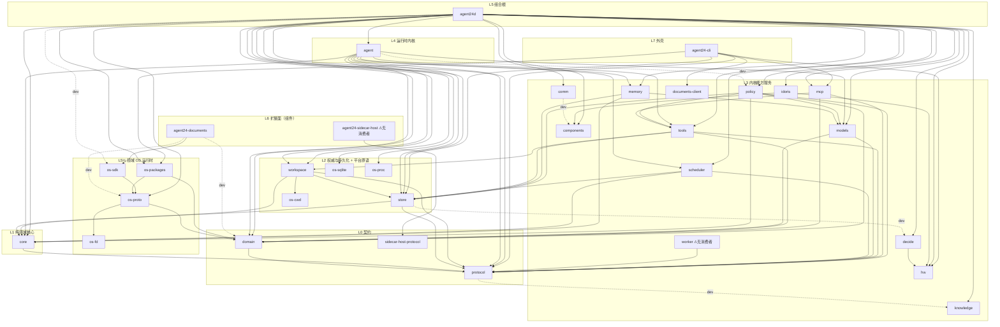
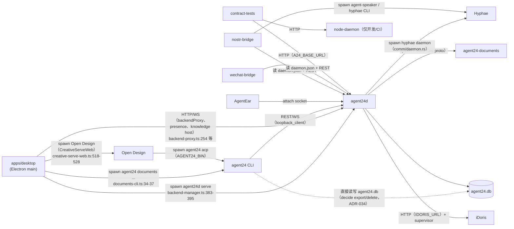

# 架构梳理 R1：代码里实际的模块关系图

索引：[架构总入口](../README.md)・[ADR 索引](../../adr/README.md)・[分层总览](../../ARCHITECTURE-LAYERS.md)・[附录：路由 owner 全表](R1-ROUTES-APPENDIX.md)

| 项 | 内容 |
|---|---|
| HEAD | `9865d7a0303cf73e2766e2f20a174159dc1bd975`（main，2026-11-03，本地 main 与 `git ls-remote` 的远端 main 一致） |
| 数据来源 | `cargo metadata --format-version 1 --no-deps --offline`（`rust/` 工作区）；`pnpm-workspace.yaml` 与各 `package.json`；各 crate / 包的入口文件（`lib.rs` / `main.rs` / `src/index.ts` 等）；`protocol/openapi.yaml`；`rust/apps/agent24d/src/capabilities/route_policy.rs`；`.github/workflows/*.yml` |
| 对照文档 | `docs/ARCHITECTURE-LAYERS.md`（2026-11-01 版，对应 `bb434b61`）、`docs/adr/ADR-039-concept-model.md`、`docs/architecture/EVOLVABILITY-ASSESSMENT-2026-11-01.md`、`AGENTS.md` |
| 生成方式 | 只读静态分析：脚本 + grep + 读源码。**没有构建、没有跑测试、没有起 daemon**。依赖图与环检测用 Python 读 `cargo metadata` 输出；行数用 [`scripts/loc.py`](scripts/loc.py)；路由用 [`scripts/openapi_ops.py`](scripts/openapi_ops.py)、[`scripts/rust_routes.py`](scripts/rust_routes.py)。部分专题（重复实现、路由、agent24d 逐文件、TS 包）由并行的只读子任务调研，主文挑结论抽查过源码（抽查点见各节「已复核」） |
| 行数口径 | 「非测试代码行」= 非空、非纯注释行。Rust 只计 `src/`；跳过 `tests/` 目录、`tests.rs` / `*_tests.rs` / `*_test.rs`；文件内顶格 `#[cfg(test)]` 后紧跟 `mod` 的，从该行到文件尾都算测试。TS 只计 `src/`（无 `src` 则包根），跳过 `node_modules`、`dist`、`test(s)`、`__tests__`、`e2e`、`fixtures`、`*.test.*`、`*.spec.*`、`*.d.ts`。所以生成代码 `api-client/src/openapi.d.ts`（8286 行）不计入 |
| 约定 | 「未核实」= 没有读到证据，不下结论。凡是现状描述，以代码为准；与 `ARCHITECTURE-LAYERS.md` 冲突时，本文列出差异，不改原文 |

---

## 0. 结论速览

1. **依赖方向总体健康**：正常依赖（normal）里**没有循环、没有下层依赖上层**；把 dev / build 依赖也算上，同样无环（§3.1）。真正的分层问题不在 Cargo 依赖，而在**组合根和外壳里堆了业务逻辑**。
2. **`ARCHITECTURE-LAYERS.md` 的依赖表已经过时**：2026-11-02 的 `0d009848`（「C1a……依赖反转」）把 `agent24-components ← agent24-idoris` 的方向倒过来了，文档还写着 components 依赖 idoris、「借用 iDoris 的下载器和锁结构」（§2.2）。
3. **agent24d 有 26,296 行非测试代码**，是全仓最大的单元。其中约 2,500 行 iDoris 托管、约 2,600 行鉴权 / enroll / presence、约 1,500 行 Knowledge 宿主，都是可以下沉的业务逻辑；`server.rs` 一个文件 2,722 行，其中 `serve()` 一个函数约 1,530 行（§4）。
4. **重复实现集中在安全敏感处**：macOS 代码签名要求有宽严两套，Team ID 写死在 6 处；`daemon.json` 有 5 个解析器，`auth_mode` 的处理各不相同；「SIGTERM → 等待 → SIGKILL」写了 7 遍（§5）。
5. **大块休眠代码**：`agent24-sidecar-host`（12,177 行）+ `-protocol`（1,662 行）+ TS `SidecarManager` 在产品路径上都没有调用方；store 里有整条没接线的 allocation / terminal 链；`knowledge_store`、`migration_guard` + `agent24-os-sqlite`、`agent24-worker` 都没有生效的生产路径（§6）。
6. **unsafe 边界比文档写的宽**：文档说生产代码只有 os-cwd、os-fd 两处 `unsafe`，实际 os-proc（8 个块）和 os-sqlite（1 个块）也开了例外（§8）。
7. **对外协议面**：代码与 OpenAPI 只有 1 处方法级漂移（`GET /approvals/{id}` 没写进 OpenAPI）。现有门禁只比路径，所以没拦住。命名风格杂：「模块」类资源分散在 5 个顶级前缀下，动词路径多，单复数、下划线混用（§7）。

---

## 1. 单元清单

### 1.1 Rust 工作区（`rust/Cargo.toml` 的 32 个 member）

「对内依赖」只列 normal 依赖；dev 依赖在括号里注明。行数口径见文件头。「总 .rs 行」是 `find <crate> -name '*.rs' | xargs cat | wc -l`，含测试，用来看测试占比。

| crate | 路径 | 职责（据入口文件） | 非测试行 | 总 .rs 行 | 对内依赖（normal） |
|---|---|---|---:|---:|---|
| agent24-protocol | rust/crates/agent24-protocol | v1 wire 类型，经 fixture 与 `protocol/` 互锁；另含 `client.rs`（loopback reqwest client）、`state_file.rs`（daemon.json，fs2 文件锁）、`data_dir.rs`、`version.rs`（lib.rs:1-3） | 1,429 | 4,367 | 无（dev：knowledge） |
| agent24-domain | rust/crates/agent24-domain | 内核↔领域 OS 契约：`DomainModule`、`KernelCtx`、`Capability`、manifest；`tool.rs` 模块工具声明；`http.rs` 模块 HTTP 信封（依赖 axum）（lib.rs:1-3，http.rs:1-16） | 1,324 | 4,714 | protocol |
| agent24-sidecar-host-protocol | rust/crates/agent24-sidecar-host-protocol | sidecar 宿主私有 v1 NDJSON 消息（lib.rs:1） | 1,662 | 1,753 | 无 |
| agent24-core | rust/crates/agent24-core | 纯状态机，只依赖 protocol（lib.rs:1-4） | 183 | 422 | protocol |
| agent24-store | rust/crates/agent24-store | sqlx SQLite 仓储、哈希链审计、workspace 权威数据、决策日志 DTO（Cargo.toml:7） | 16,331 | 42,326 | core, protocol（dev：decide） |
| agent24-workspace | rust/crates/agent24-workspace | `WorkspaceService` / `WorkspaceHandle`（lib.rs:10） | 747 | 1,907 | core, protocol, store, os-cwd |
| agent24-os-cwd | rust/crates/agent24-os-cwd | post-fork `fchdir`（lib.rs:1） | 11 | 50 | 无 |
| agent24-os-sqlite | rust/crates/agent24-os-sqlite | 在两个 sqlx 连接的原生句柄上做 SQLite online backup（lib.rs:1） | 50 | 127 | 无 |
| agent24-os-proc | rust/crates/agent24-os-proc | 进程身份原语：pid 存活、audit token、代码签名校验（lib.rs:1） | 332 | 540 | 无 |
| agent24-models | rust/crates/agent24-models | 模型网关 + `ModelRouter` + iDoris provider（lib.rs:1） | 1,906 | 7,010 | domain, protocol |
| agent24-tools | rust/crates/agent24-tools | `Tool` trait + 注册表 + 固定流水线 + 内建工具（lib.rs:1-3） | 2,693 | 5,617 | domain, protocol, store, workspace |
| agent24-policy | rust/crates/agent24-policy | fail-closed 审批 + Guardian（lib.rs:1-3） | 1,725 | 5,829 | core, domain, models, protocol, store, tools |
| agent24-memory | rust/crates/agent24-memory | M-D 记忆：KvStore、SessionLog，以及 16 个 trait 的高层模块（lib.rs:1-3） | 4,949 | 19,739 | core, models, store |
| agent24-scheduler | rust/crates/agent24-scheduler | cron / every / at 调度（lib.rs:1-3） | 1,466 | 5,977 | core, protocol, store |
| agent24-mcp | rust/crates/agent24-mcp | 外部 MCP server 适配，工具包装成普通 `Tool`（lib.rs:1-3） | 481 | 1,531 | domain, protocol, tools |
| agent24-comm | rust/crates/agent24-comm | Hyphae CLI 调用层 + **axum REST 路由**（router.rs 1,447 行）+ hyphae daemon 监管（daemon.rs 1,077 行）（lib.rs:1-3） | 4,855 | 21,051 | 无（dev：components、自身） |
| agent24-components | rust/crates/agent24-components | 通用组件机制：schema-2 `ComponentLock`、固定版本下载器、不可变安装器、D2a 签名校验（lib.rs:1-4） | 2,080 | 4,500 | **无** |
| agent24-idoris | rust/crates/agent24-idoris | iDoris 固定版本元数据 + launcher 契约兼容 + 安装 + supervisor（lib.rs:1） | 2,398 | 7,671 | **components**, hw |
| agent24-hw | rust/crates/agent24-hw | 硬件探测 + 内存账（lib.rs:1-3） | 610 | 1,643 | 无 |
| agent24-decide | rust/crates/agent24-decide | 决策服务契约 + RuleBackend + 决策日志 trait（lib.rs:1-3） | 667 | 2,183 | hw |
| agent24-knowledge | rust/crates/agent24-knowledge | Knowledge v1 wire 类型、HTTP 传输、Mock、工具层，以及约 4,100 行 `provider/`（lib.rs:1-20） | 6,145 | 19,444 | 无 |
| agent24-worker | rust/crates/agent24-worker | Python ML Worker 的 Rust 侧契约 + HTTP 客户端（lib.rs:1-3） | 309 | 841 | **protocol** |
| agent24-documents-client | rust/crates/agent24-documents-client | `/api/v1/documents` 的客户端，CLI 与桌面共用（桌面经 CLI 调用）（lib.rs:1-5） | 945 | 3,699 | 无 |
| agent24-agent | rust/crates/agent24-agent | run 管理器 + agent loop（lib.rs:1-3） | 3,863 | 16,443 | core, domain, memory, models, protocol, scheduler, store, tools, workspace（dev：policy） |
| agent24-os-proto | rust/crates/agent24-os-proto | 内核↔进程外模块协议：入站代理、出站回调、握手、启动、监管（lib.rs:1-3） | 7,929 | 28,468 | domain, os-fd |
| agent24-os-fd | rust/crates/agent24-os-fd | 继承 fd 转 socket（lib.rs:1-2） | 77 | 290 | 无 |
| agent24-os-packages | rust/crates/agent24-os-packages | 领域 OS 包的发现与原子安装（lib.rs:1-3） | 475 | 2,528 | domain, os-proto |
| agent24-os-sdk | rust/crates/agent24-os-sdk | 给模块作者的 SDK（lib.rs:1-3） | 1,834 | 2,865 | os-proto |
| agent24d | rust/apps/agent24d | 内核组合根：v1 REST/WS、鉴权、领域 OS 挂载、附着、组件托管、启动序列（main.rs:1-4） | **26,296** | 96,765 | agent, comm, components, core, decide, domain, hw, idoris, knowledge, mcp, memory, models, os-packages, os-proc, os-proto, os-sqlite, policy, protocol, scheduler, store, tools, workspace（dev：comm, os-sdk） |
| agent24-cli | rust/apps/agent24-cli | `agent24` CLI / TUI / `agent24 acp`（main.rs:1-3） | 6,576 | 16,679 | documents-client, hw, mcp, os-packages, protocol, store |
| agent24-documents | rust/apps/agent24-documents | Documenting 进程外领域 OS 二进制（lib.rs:1-3，main.rs:1-3） | 7,969 | 29,280 | os-sdk（dev：domain, os-proto） |
| agent24-sidecar-host | rust/apps/agent24-sidecar-host | 桌面 sidecar 生命周期的 Rust 宿主（lib.rs:1-2） | 12,177 | 15,301 | sidecar-host-protocol |

合计 Rust 非测试行 120,494（约 12.0 万），其中 agent24d 占 21.8%。
**已复核**：`cargo metadata` 的依赖列，逐个对过 `Cargo.toml`（如 `agent24-idoris/Cargo.toml:9-10`、`agent24-worker/Cargo.toml:10`、`agent24-protocol/Cargo.toml:23` 是 dev 段、`agent24-store/Cargo.toml:22` 是 dev 段）。

### 1.2 pnpm 工作区（`pnpm-workspace.yaml`：`apps/*`、`packages/*`）

| 包 | 路径 | 职责（据入口） | 入口 | 非测试行 | 声明的 workspace 依赖 | 未声明但实际引用 |
|---|---|---|---|---:|---|---|
| @agent24/desktop | apps/desktop | Electron 壳。main 进程托管 daemon、IPC、Open Design、Knowledge；renderer 是 React（main 6,519 行 / renderer 9,451 行 / shared 534 行） | `src/main/main.ts` | 16,525 | api-client, data-dir | `packages/node-daemon/dist/server.js`（backend-manager.ts:147，开发时用，按注释是有意不声明）；打包资源 `rust/target/release/agent24{,d}`（package.json:88-136） |
| @agent24/api-client | packages/api-client | 由 `protocol/openapi.yaml` + `events.schema.json` 生成的 TS 类型；`src/index.ts` 是手写的转出口文件 | `src/index.ts` | 30（另有生成的 `openapi.d.ts` 8,286 行、`events.d.ts` 517 行） | 无 | `gen` 脚本读 `../../protocol/`（package.json:10） |
| @agent24/contract-tests | packages/contract-tests | 对任意 daemon 跑契约断言。CI 分别对 node-daemon（ci.yml:254-270）和 agent24d（ci.yml:280-343）各跑一遍 | vitest `src/*.test.ts` | 55 | 无 | 读 `protocol/` 下的 schema 和 fixtures（v1.test.ts:16,23） |
| @agent24/data-dir | packages/data-dir | 数据目录解析，镜像 `agent24-protocol/src/data_dir.rs`，用共享 fixture 锁定（index.ts:1-4） | `dist/index.js` | 60 | 无 | 测试读 `protocol/fixtures/data-dir/cases.json` |
| @agent24/documents-accept | packages/documents-accept | Documenting 验收工具，`accept run/review`（cli.ts:1-8） | `src/cli.ts` | 1,692 | data-dir, api-client（dev） | `protocol/openapi.yaml`（contract.ts:12） |
| @agent24/node-daemon | packages/node-daemon | Node 参考 / mock daemon（server.ts:1-3）。只实现 124 个 v1 op 中的 4 个（v1/routes.ts:60-89） | `dist/server.js` | 1,506 | data-dir | — |
| @agent24/nostr-bridge | packages/nostr-bridge | Nostr 入站消息变成有门控的 run（main.ts:1-10） | `src/main.ts` | 1,473 | data-dir | 拉起外部 `agent-speaker` 和 `hyphae`（speaker.ts:44-47, 75-78） |
| @agent24/wechat-bridge | packages/wechat-bridge | 微信 iLink 消息变成 run，审批回到聊天里（main.ts:1-8） | `src/main.ts` | 1,067 | data-dir | — |

TS 非测试行合计约 2.2 万。
包间依赖：desktop → api-client、data-dir；documents-accept → data-dir、api-client；node-daemon / nostr-bridge / wechat-bridge → data-dir。**TS 侧与 Rust 侧之间没有编译期依赖**，只靠进程、HTTP 和文件交互（§2.2）。

---

## 2. 依赖图

### 2.1 Rust（normal 依赖；虚线 = 仅 dev 依赖；省略 `agent24-` 前缀）

为了可读性，`protocol` 的 13 条入边只画到 L0 / L1 / L2 的直接消费者；完整列表见 §1.1。

### 2.2 进程与跨语言关系（运行时，不是编译依赖）

---

## 3. 分层归属与对照

### 3.1 归层表

依据有三条：`ARCHITECTURE-LAYERS.md` §1、§2 的原有归属；入口文件写明的职责；实际依赖方向（下层不得依赖上层）。「文档」列标出与 `ARCHITECTURE-LAYERS.md` 的差异。

| 层 | 单元 | 归层依据 | 与文档的差异 |
|---|---|---|---|
| L0 契约 | agent24-protocol、agent24-domain、agent24-sidecar-host-protocol、`protocol/`；TS 侧 `@agent24/api-client`（L0 的生成物）、`@agent24/data-dir`（`data_dir.rs` 的镜像） | 只依赖 protocol 或无内部依赖；入口自述是 wire / 契约 | 一致。补充：L0 带有少量运行时代码，见 §3.3 第 2 条 |
| L1 纯核心 | agent24-core | 只依赖 protocol（core/lib.rs:1-4） | 一致 |
| L2 权威与持久化 | agent24-store、agent24-workspace、agent24-os-cwd | 依赖只到 core / protocol | 一致 |
| L2（平台原语） | agent24-os-sqlite、agent24-os-proc | 无内部依赖，只被 agent24d 使用；内容是 OS 原语，不是领域 OS | **文档 §1 的大图和 §2 都没有给它们归层**，只出现在 §1.1 的依赖表里 |
| L3 能力服务 | models、tools、policy、memory、scheduler、mcp、comm、hw、decide、components、idoris、knowledge、worker | 依赖只到 L0–L2 和 L3 内部 | 一致。补充：L3 不是平的，内部有依赖链（policy→tools→workspace、memory→models、mcp→tools、idoris→components、decide→hw） |
| L3（客户端库） | agent24-documents-client | 无内部依赖，只被 CLI 使用 | **文档没有归层**。它是 L6 组件 documents 的客户端，归在 L3 或 L7 的支撑库都说得通，本文暂放 L3 |
| L4 运行时内核 | agent24-agent | 依赖 L0–L3，policy 只是 dev 依赖 | 一致 |
| L5 组合根 | agent24d | 依赖 22 个内部 crate，没有 crate 反向依赖它 | 一致 |
| L5½ 领域 OS 运行时 | os-proto、os-fd、os-packages、os-sdk | 只依赖 domain 和本组内部 | 一致。注意 L5½ 并不依赖 L5，它被 L5（agent24d）和 L6（documents）同时依赖；「5½」这个编号让人以为它在 L5 之上，实际是 L5 和 L6 共用的下层 |
| L6 扩展面 | agent24-documents（进程外组件）、agent24-sidecar-host（④ sidecar 目标形态的宿主）；外部的 Sin90、Cos72、AgentEar、iDoris、Hyphae、Open Design | 运行在独立进程里，依赖 L5½ 或自有协议 | 一致。按 ADR-039，应统一称「组件」（ADR-039 §4、§6 要求改写 L6，**尚未改**） |
| L7 外壳 | agent24-cli、apps/desktop、nostr-bridge、wechat-bridge；开发 / 测试工具：node-daemon、contract-tests、documents-accept | 用户入口，或经 REST 访问 daemon 的客户端 | 文档把 node-daemon、contract-tests 也列在 L7，本文沿用，但标为「开发 / 测试工具」 |

### 3.2 跨层反向依赖与循环依赖

| 检查 | 结果 | 证据 |
|---|---|---|
| normal 依赖里有没有环 | **无** | 用 DFS 扫 `cargo metadata` 输出：`normal cycles: []` |
| 算上 dev 和 build 依赖有没有环 | **无** | 同一脚本：`all cycles: []` |
| normal 依赖里有没有下层依赖上层 | **无** | 逐条核对 §2.1 的边：所有边都指向同层或下层 |
| dev 依赖里有没有下层依赖上层 | **有 2 条，只影响测试** | `agent24-protocol`（L0）dev 依赖 `agent24-knowledge`（L3），见 `agent24-protocol/Cargo.toml:23`，只在 `tests/knowledge_fixtures.rs:14` 使用；`agent24-store`（L2）dev 依赖 `agent24-decide`（L3），见 `agent24-store/Cargo.toml:22`，用于 `module_audit_event.rs:776`，它在 649 行的 `#[cfg(test)]` 之后 |
| 跨层跳跃 | **CLI（L7）直接链接 L2 的 store、L5½ 的 os-packages、L3 的 mcp / hw** | `agent24-cli/Cargo.toml:19-27`。store 用于 `decide export/delete` 直接读写 `agent24.db`，ADR-034 和文档 §1.1 都已说明。这是有意绕过 daemon，但意味着 CLI 和 daemon 会同时打开同一个 SQLite 文件 |
| 依赖方向与文档相反 | **有** | 见下表 |

**文档依赖表（`ARCHITECTURE-LAYERS.md` §1.1）与代码的差异**

| 文档原文 | 代码现实 | 证据 |
|---|---|---|
| L75「worker……（无内部依赖）」 | worker 依赖 protocol | `agent24-worker/Cargo.toml:10` |
| L78「idoris \| hw」 | idoris 依赖 **components** 和 hw | `agent24-idoris/Cargo.toml:9-10` |
| L79「components \| idoris」 | components **没有内部依赖** | `cargo metadata` 中 components 的 deps 为空 |
| L97「`components` 的下载器借用 `idoris`」；L152「只依赖 `agent24-hw`」；L153「借用 iDoris 的下载器和锁结构」；L317「`fetch_verified` 复用 `agent24_idoris` 的下载器、`IdorisLock`」 | 已反转：`ComponentLock` 和下载器在 components 里，iDoris 的 `IdorisLock` 是它之上的视图（`agent24-idoris/src/lib.rs:27-41, 192-217`）；`fetch_verified` 在全仓已不存在（grep 无结果） | 提交 `0d009848`（2026-11-02）「C1a —— ComponentLock schema 2、通用下载器与签名验证、依赖反转」，比文档的 11-01 更新晚一天 |
| 可进化性评估第 25 行「`fetch_verified` 依赖 iDoris 锁结构：成立」 | 同上，已被 C1a 修掉 | 同上 |

### 3.3 不在 Cargo 依赖里、但属于分层问题的现象

| # | 现象 | 证据 | 影响 |
|---|---|---|---|
| 1 | **L3 的 agent24-comm 自带对外 REST 面**：axum router（1,447 行）+ hyphae daemon 监管（1,077 行）。路由前缀 `/api/v1/comm` 却由 agent24d 加 | `agent24-comm/Cargo.toml:19`（axum）；`comm/src/router.rs:167-186`；`agent24d/src/comm_routes.rs:622, 636` 做 `nest("/api/v1/comm")` | 一个 L3 服务同时拥有对外协议（L5 关心的事）。别的 L3 crate 都不这样，comm 是孤例 |
| 2 | **L0 契约层带运行时依赖**：protocol 依赖 reqwest（`client.rs` 15 行）和 fs2（`state_file.rs` 244 行）；domain 依赖 axum / tokio（`http.rs` 71 行） | `agent24-protocol/Cargo.toml:9-21`；`domain/Cargo.toml:12, 20`；`domain/src/http.rs:1-16` 写明是有意收口，避免 copy 漂移 | 小。代价是每个 L0 消费者（包括 worker、core）都会编译 reqwest 和 axum。可以接受，记为观察项 |
| 3 | **组合根承担了 L3 / L5½ 的业务**：iDoris 托管、Knowledge 宿主、attach 注册表、鉴权 | 见 §4 | 主要问题 |
| 4 | **外壳承担了应在 daemon / CLI 共享的业务** | 见 §5.6 | 违反 AGENTS.md:26 |

---

## 4. agent24d：组合根里本该下沉的业务逻辑

agent24d 非测试 26,296 行，按职责分组如下。行数是非测试行，`idoris_host/provision.rs` 单独计。

| 职责组 | 文件（非测试行） | 小计 | 是不是业务逻辑 | 可下沉的目标 | 证据 / 阻碍 |
|---|---|---:|---|---|---|
| **iDoris 托管** | idoris_host.rs 1,286；idoris_host/provision.rs 1,045；managed_idoris.rs 170；idoris_routes.rs 137 | 2,638 | 是：安装元数据、状态机、Operation、监督、网关发布、安装 / 连接事务 | **agent24-idoris**（routes 留在 agent24d） | **成本最低**：它们已经在 lib target 里（`agent24d/src/lib.rs` 只有 `pub mod managed_idoris; pub mod idoris_host;`），`provision.rs` 不依赖 `crate::`，idoris_host 只依赖 `crate::managed_idoris`，唯一的 axum 用法是 `http_status()`（idoris_host.rs:1, 43, 120, 158-159）。新增边 idoris → models 属于 L3 内部 |
| **鉴权：capability token、enroll、presence** | enroll_endpoint.rs 1,614；presence_desktop.rs 819；capabilities/*（first_party 640、route_policy 233、operations 180、validate 163、mint 140、types 129、store 81、revoke 80、token 79、delegation 74、presence 36、watch 26、mod 25）；enroll_api.rs 110；authz.rs 46；host_bootstrap.rs 55；另有 server.rs 内的鉴权中间件约 390 行（server.rs:1025-1418） | 约 4,900 | 是：帧协议、对端代码身份校验、令牌库、TTL 与代际、在场确认队列 | 新 crate（暂名 agent24-auth）。HTTP handler 和中间件接线留在 agent24d | enroll_endpoint 依赖 os-proc（24 处）和 `crate::capabilities`（15 处）；presence 的队列逻辑（presence_desktop.rs:77-281）是纯业务，handler（371、411）是胶水；Team ID 写死在 enroll_endpoint.rs:22（见 §5.1） |
| **Knowledge 宿主** | knowledge_host.rs 556；knowledge_backend.rs 404；knowledge_store.rs 212；knowledge_tools.rs 163 | 1,335 | 是：绑定与凭据注册表、后端调用、`knowledge.db` 存储、两个 Tool | agent24-knowledge（它已有 `provider/host/`）。handler 留下 | `knowledge_store` **生产代码零调用**（`main.rs:49` 的 `#[allow(dead_code)]`；grep `knowledge_store::` / `KnowledgeDb` 在其文件外无结果）；`knowledge_backend.rs:6` 自述「Provider is not wired yet」 |
| **Comm / Hyphae** | comm_routes.rs 647；hyphae_install.rs 181 | 828 | 部分是：`CommDaemonSlot`（安装时排空请求、替换 CommState）和二进制解析（comm_routes.rs:68-270）是业务；`hyphae_install` 是下载、验签、安装 | `CommDaemonSlot` → agent24-comm；hyphae_install → agent24-components（或新的 hyphae 组件 crate） | comm 刻意不带 reqwest（`comm/Cargo.toml:87` 注释），所以安装放在 comm 之外；`/comm/install` 只在 `runtime_router` 注册（comm_routes.rs:635），`unconfigured_router` 分支没有它（comm_routes.rs:473, 621），是否属于预期「未核实」 |
| **附着模块（A3）** | attached.rs 491；attach_registry.rs 408；attach_listener.rs 192；attached_routes.rs 168；attach_commands.rs 150；agentear_timings.rs 110 | 1,519 | 是：注册表、命令槽、grant 构建、监听与握手 | 整个 attach 子系统一起迁到新 crate（暂名 agent24-attach）。**不能单独迁 attach_registry**，也不宜并入 os-proto | attach_registry 依赖 `crate::attached`（14 处）、attach_listener（8 处）、domain（6 处）、events、model_callback。如果并入 os-proto，协议 crate 就要依赖 scheduler / store，方向反了 |
| **领域 OS 挂载与回调** | domain.rs 1,113；model_callback.rs 777；os_routes.rs 717；os_memory.rs 627；scheduler_callback.rs 456；module_tool_runtime.rs 418；os_memory_page.rs 389；module_approval_broker.rs 363；approval_callback.rs 223；memory_callback.rs 182；scheduler_deliver.rs 155；os_config.rs 176 | 5,596 | 部分是。domain.rs 是内核本体（挂载、监督），留在组合根；`os_memory`（`ScopedMemory` 的分区 key、key 版本、recall 分页）是 memory 的业务；model_callback 的准入、限流、错误映射（374、611）是 models 的业务 | os_memory → agent24-memory（一个 scoped 层）；model_callback 的准入部分 → agent24-models 或新的回调 crate；其余留下 | os_memory 用了 agent24-memory 的 83 处，只依赖本地的 os_memory_page 和 events_emit（os_memory.rs:1-8, 206-279, 873）；domain.rs 依赖 events（67 处）、os_memory（51 处）等 16 个本地模块，不宜迁 |
| **迁移保护（CORE-5，未接线）** | migration_guard/*（restore 281、manifest 275、space 260、dock 249、snapshot 219、guard_log 181、startup 135、atomic 109、replay 56、mod 9）；migration_coordinator.rs 102；docked_startup.rs 246；docked_router.rs 188 | 2,310 | 是，但目前不生效 | 接线前不迁 | `migration_coordinator::ENABLED = false`（migration_coordinator.rs:20），main.rs 有编译期断言；`docked_startup::guard_enabled()` 就是这个常量（docked_startup.rs:69-78） |
| **组件聚合** | component_routes.rs 463 | 463 | 不是，是聚合 iDoris、Hyphae、attached、Documents、Knowledge 状态的胶水 | 留下 | component_routes.rs:189, 394, 515 |
| **server.rs 本体** | server.rs 2,722（整个文件 8,734 行，3,813 行起是测试） | 2,722 | **混合** | 拆文件，不一定拆 crate | 见下表 |
| 其余（runs、routes、lifecycle、schedules、approvals、events、consent_routes、overrides、usage / timing recorder、memory_routes、grant_expiry、peer_runs、mcp、hardware、decide_routes 等） | 合计约 4,350（含 main.rs 243） | — | 大多是 handler 和接线 | 留下 | 职责逐个「未核实」，只看了行数 |

**server.rs 的构成**（子任务读源码得出；已复核 `authorize` 在 1166 行、`build_router_with_modules` 在 1446 行、`serve` 在 1888 行、`#[cfg(test)]` 在 3813 行）

| 区段 | 内容 | 约行数 |
|---|---|---:|
| 36-800 | `AppState` / `AppDeps`、`Shutdown` 状态机、`ModelCatalog`（实现 `ModelInventory`）、`KernelTrigger`（实现 `RunTrigger`）、Guardian 构建、打开 memory | 760 |
| 803-1025 | health、shutdown、**capability mint / revoke handler**（880、981） | 220 |
| 1025-1418 | **鉴权中间件**：legacy 与 capability 两种认证、`authorize`、模块委派 | 390 |
| 1435-1690 | 路由接线（**真正的「组合」只有这一段**） | 255 |
| 1888-3417 | **`serve()` 一个函数**：整个启动序列，包括 docked startup（2088）、iDoris（2135-2151）、WorkspaceService（2397） | 1,530 |
| 3417-3812 | 启动模式和鉴权校验、`secure_fallback_dir`、watchdog、`stop_supervisors` | 395 |

---

## 5. 职责重叠与重复实现

已复核：A3（`os-proc/src/lib.rs:249-262` 对比 `components/src/sign.rs:175-192`）、D1b（`idoris/src/install.rs:22-24`）、E6 的 Rust 侧（`components/src/state.rs:130` 在生产代码无调用）。其余条目来自子任务读码，file:line 由子任务给出。

### 5.1 签名与哈希校验

| # | 重复了什么 | 位置 | 差异 | 风险 |
|---|---|---|---|---|
| A3 | macOS 代码签名的「团队 + 证书」要求 | `agent24-os-proc/src/lib.rs:249-262`（运行中进程，enroll 用）；`agent24-components/src/sign.rs:178-192`（安装文件用） | os-proc 对 Team ID 只要求非空且是字母数字，requirement 里**没有** Developer ID 证书链标记（`6.2.6` / `6.1.13`）；components 要求 10 位大写字母或数字，并且必须带证书链标记，注释写明「Mac App Store 或开发证书不得通过」 | **高**：enroll 接受的签名范围比安装更宽 |
| A4 | Team ID `HYAP444FN9` 写死在 6 处 | `agent24d/src/enroll_endpoint.rs:22`（代码常量）；`agent24-idoris/idoris.lock.json:25`；`agent24-comm/hyphae.lock.json:63`；`apps/desktop/package.json:96`；`scripts/sign-cli-mac.sh:13`；`apps/desktop/scripts/release-mac.sh:22` | 锁文件里的是数据，enroll 里的是代码，之间没有一致性检查 | **高**：换团队时漏改一处，enroll 或安装就会全部失败 |
| A1 | 「按锁取签名要求再调 verifier」 | `agent24d/src/hyphae_install.rs:139-170`；`agent24-components/src/install.rs:176-192` | 一个异步、只验单文件；一个同步、逐个验 `executables` | 中：改签名策略要改两处 |
| A2 | 同一个 Hyphae 二进制的 sha256 比两次 | `components/src/download.rs:379`（比字符串，要求小写）；`comm/src/binary.rs:34, 107`（比字节，大小写不敏感） | 两种解析规则 | 低：属于纵深防御 |
| A6 | enroll 请求体的 sha256，客户端和服务端各写一份 | `agent24-cli/src/enroll.rs:72`；`agent24d/src/capabilities/first_party.rs:664` | 目前输出一致 | 中 |
| A7 | Open Design 下载的完整性校验是一套独立流程 | `apps/desktop/src/main/open-design-component.ts:141, 229, 239, 269` | 不用 `ComponentLock`；运行时不验 codesign | 中：组件安全策略分成了 Rust 和 TS 两套 |

### 5.2 锁文件与 pin

| # | 重复了什么 | 位置 | 风险 |
|---|---|---|---|
| B1 | 锁文件解析 | **已收口**：只有 `agent24-components/src/lock.rs:173` 一个解析器，iDoris 和 Hyphae 都是它之上的视图 | — |
| B2 | `IdorisLock` 把 `ComponentLock` 的字段抄了一遍，再用 `to_component` 回写 | `agent24-idoris/src/lib.rs:27-41, 192-217` | 中：`ComponentLock` 加字段后，视图上的改动可能不会回写 |
| B5 | 契约版本检查有三份 | `idoris/src/lib.rs:236`（semver）；`components/src/lock.rs:311`；`idoris/src/supervisor.rs:961` 写死 `v.major != 1` | 中：只升锁文件的 major，supervisor 仍会拒绝 |
| B7 | 锁里的 `stop_grace_ms` 声明了但没人读 | `components/src/lock.rs:30`；实际 grace 来自 `agent24d/src/lifecycle.rs` 和 `comm_routes.rs:469` | 中：同一参数两个来源，锁里的值不生效 |
| B8/B9 | Open Design 的 pin SHA 写在 3 处、版本 `0.26.1` 写在 4 份常量和 2 处 CI | `.github/workflows/release-desktop.yml:39, 295, 345`；`apps/desktop/scripts/pack-open-design-component.mjs:36-37`；`prepare-open-design-linux-resources.mjs:13-14`；`stage-open-design-resources.mjs:5`；`creative-serve-web.ts:70` | 中：#1555 也是手动同时改这几处，没有一致性测试 |

### 5.3 下载器与安装器

| # | 重复了什么 | 位置 | 差异 | 风险 |
|---|---|---|---|---|
| C1 | HTTP 下载 + 校验，Rust 和 TS 各一套 | `agent24-components/src/download.rs:155`（iDoris、Hyphae 共用）；`apps/desktop/src/main/open-design-component.ts:1085` | Rust 额外要求端口 443、URL 不带用户名密码（download.rs:428-434）；TS 只检查 https 和主机名，但支持 Range 续传 | 中：安全基线会漂移 |
| C2 | tar 解包 | `components/src/install.rs:652`（进程内）；`open-design-component.ts:470, 1001`（调系统 tar） | 路径安全规则各写各的 | 中 |
| C3 | 用隔离子进程写可执行文件 | `comm/src/binary.rs:134, 215`（`/bin/cp`）；`components/src/install.rs:429, 537`（自身作为子进程） | 同一个问题解决了两遍 | 低到中 |
| C4 | 平台键推导有 3 份 | `comm/src/binary.rs:72`；`components/src/lock.rs:143`；`idoris/src/lib.rs:76-105` | 未知平台时错误语义不同 | 低 |
| C5 | 「复验已安装的 iDoris」写了两处 | `agent24d/src/idoris_host.rs:427-457`（依赖注入）；`idoris_host/provision.rs:151-166`（写死 `embedded()` 和 `Codesign`） | provision 路径绕过了依赖注入，测试替身覆盖不到 | 中 |

### 5.4 数据目录、daemon.json、token

| # | 重复了什么 | 位置 | 差异 | 风险 |
|---|---|---|---|---|
| D1 | 数据目录解析 | `agent24-protocol/src/data_dir.rs:75`；`packages/data-dir/src/index.ts:49` | 故意镜像，由 `protocol/fixtures/data-dir/cases.json` 锁定 | 低（合理） |
| D1b | **iDoris 状态目录绕过了统一解析器** | `agent24-idoris/src/install.rs:22-24`，写死 `$HOME/Library/Application Support/Agent24/idoris`；调用处 `agent24d/src/server.rs:1926` | 不认 `AGENT24_DATA_DIR`，在 Linux 上路径也不对；同一处的 release 目录（server.rs:1930）却走 data_dir | 中：自定义数据目录或隔离测试时，iDoris 状态会漏写到真实 HOME |
| D2 | **`daemon.json` 有 5 个解析器** | Rust：`agent24-protocol/src/state_file.rs:263`（validate + pid 存活）。TS：`apps/desktop/src/main/backend-manager.ts:282`；`packages/wechat-bridge/src/config.ts:69`；`packages/nostr-bridge/src/config.ts:126`；`packages/documents-accept/src/client.ts:21` | 只有 Rust 做 validate 和 pid 检查；desktop 把未知 `auth_mode` 当成 capabilities；两个 bridge 忽略 `auth_mode`，token 缺失时发空 token；documents-accept 要求 token 非空 | **高**：capability 模式下各客户端行为不一致 |
| D3 | 两个 bridge 的 daemon 发现和客户端是复制粘贴 | `wechat-bridge/src/config.ts:69` ↔ `nostr-bridge/src/config.ts:126`；两边的 `agent24.ts` 只差 channel 名、超时和 approvals 方法 | 都没用 `@agent24/api-client` | 中 |
| D5 | 协议版本兼容判定 | `agent24-protocol/src/version.rs:18`；`apps/desktop/src/main/protocol-compatibility.ts:10-29` | 故意镜像，有共享 fixture | 低（合理） |
| D6 | CLI 访问 daemon 的 HTTP client | **已收口**到 `agent24-protocol/src/client.rs:16` 的 `loopback_client` | — | — |

### 5.5 状态映射

| # | 重复了什么 | 位置 | 风险 |
|---|---|---|---|
| E1 | `RunStatus` 转 SQL 字符串写了两份相同的 match；反向解析一处用 serde、一处手写 | `agent24-store/src/repo.rs:42, 84`；`terminal_mutations.rs:36`；`legacy_recovery.rs:200-205`；SQL 字面量在 `repo.rs:40, 464-467`、`migrations/0012_legacy_recovery_holds.sql:31` | 中：新增状态时手写 match 会编译报错，但 SQL 字面量不会 |
| E2 | 状态迁移规则 | **已收口**到 `agent24-core/src/transitions.rs:25` | — |
| E3 | `RunStatus` 在 TS 里手写了 3 份，都没用生成类型 | `apps/desktop/src/renderer/pages/agent/api.ts:8`；`wechat-bridge/src/agent24.ts:9`；`nostr-bridge/src/agent24.ts:12`；生成版在 `api-client/src/openapi.d.ts:2553` | 中：新增状态时 TS 不报错 |
| E6 | **Open Design 状态映射，Rust 和 TS 各一份且结论不同** | Rust：`agent24-components/src/state.rs:128-130` `from_open_design`（`downloading` / `verifying` 映射为 None，`paused` 映射为 Installing），**生产代码无调用方**。TS：`apps/desktop/src/main/open-design-report.ts:84` `mapInstallState`（三者都映射为 installing） | 中：两份「权威映射」互相矛盾，其中 Rust 那份是死代码 |
| — | 决策日志 DTO 在 store 和 decide 各有一份 | `agent24-store/src/decision_log.rs:28-93`；`agent24-decide/src/log.rs:85` | 低：ADR-034 有意让 store 不依赖 decide。目前 decide 的 trait 没有实现，两份 DTO 之间没有映射代码 |

### 5.6 进程监管，以及外壳与 CLI 的业务重复

| # | 重复了什么 | 位置 | 风险 |
|---|---|---|---|
| F1 | **「SIGTERM → 等待 → SIGKILL」写了 7 遍** | Rust：`agent24-sidecar-host/src/posix.rs:235`；`agent24-os-proto/src/supervise.rs:551, 632`；`agent24-comm/src/daemon.rs:294`；`agent24-idoris/src/supervisor.rs:697`。TS：`apps/desktop/src/main/sidecar-manager.ts:110`；`creative-serve-web.ts:622`（超时后不发 SIGKILL）；`backend-manager.ts:823`（只发 SIGTERM） | **高**：每份对回收（reap）、超时、macOS 僵尸进程的处理都不一样，同类 bug 要修 7 次 |
| F2 | 有两套 sidecar 托管实现，产品路径都不用 | `rust/apps/agent24-sidecar-host`（只有 `.github/workflows/sidecar-windows.yml` 构建它）；`apps/desktop/src/main/sidecar-manager.ts`（只被 `sidecar-manager.test.ts` 导入）。实际跑 Open Design 的是 `creative-serve-web.ts` | 中：维护成本翻倍，也容易让人误以为生产行为由它们保证 |
| G1 | **桌面端托管 daemon 和 CLI 托管 daemon 是两套实现** | 桌面：`backend-manager.ts`（拉起、解析 ready 行、健康检查、重启、选择认证模式）；CLI：`agent24-cli/src/main.rs:559-566, 700, 791-792`（`daemon start/status/stop`、`parse_ready_state`） | 中：AGENTS.md:26 点名「托管 daemon」必须两边共用 |
| G2 | 桌面端有业务逻辑、CLI 没有入口 | Knowledge 绑定和凭据（`knowledge-host/settings/logins.ts`）；presence 确认（`presence-poller.ts`）；Open Design 下载、启动、上报（`open-design-component.ts`、`creative-serve-web.ts`、`open-design-report.ts`）；Comm 密钥备份和恢复（`ipc/index.ts:706, 823` + `backup-*.ts`，CLI 的 `CommIdentityAction` 只有 List/Create/Use，main.rs:493-506） | 中：违反 AGENTS.md:26，这些功能的 release 用例只能在桌面端跑。合规样板只有 Documents（`documents-cli.ts:1-6` 直接调 CLI） |
| G3 | Comm 输入校验写了两份 | `apps/desktop/src/main/comm-validate.ts`；CLI 的 `comm` 子命令（main.rs:377-480） | 低 |
| G4 | Nostr 收发：nostr-bridge 自己拉起 hyphae 和 agent-speaker，agent24-comm 也托管 hyphae daemon | `nostr-bridge/src/speaker.ts:44, 75`；`agent24-comm/src/daemon.rs:1, 734`、`router.rs:167-186` | 中：身份、发送、历史这一层重复。「入站消息变成有门控的 run」只有 bridge 有（`nostr-bridge/src/inbound.ts:1-4`），Rust 侧没找到对应实现（只 grep 了 inbox / inbound 两个关键字） |

---

## 6. 名不副实、死代码、只被测试引用

### 6.1 名不副实或容易误读

| 对象 | 问题 | 证据 |
|---|---|---|
| `agent24-os-*` 前缀 | **一个前缀两种意思**：os-proto / os-sdk / os-packages 的 os 指「领域 OS」；os-proc / os-sqlite / os-cwd / os-fd 的 os 指「操作系统原语」 | 各 lib.rs 第 1 行 |
| agent24-comm | 名字是「通信」，实际还有对外 REST 面和 hyphae 进程监管 | `comm/src/router.rs:1-4`、`daemon.rs:1-2`、`Cargo.toml:19` |
| agent24-knowledge | 文档描述是「wire 类型、传输、Mock、Provider 与工具调用层」，实际约 2/3（约 4,100 行）是基本没接线的 `provider/` | lib.rs:1-20；agent24d 生产代码只用了 `provider::state::{LocalReason, Refusal}` |
| agent24-workspace | lib.rs 第 1 行写「Filesystem and persistence behavior live in later slices」，但 `service.rs` 已经实现，并被 server.rs:2397 和 agent24-agent 使用 | `agent24-workspace/src/lib.rs:1, 10` |
| agent24-domain | 指「领域 OS 契约」，容易被误读成业务领域模型；按 ADR-039，对内应称「组件契约」 | domain/src/lib.rs:1-3；ADR-039 §4 |
| L5½ | 编号让人以为在 L5 之上，实际被 L5 和 L6 共同依赖 | §3.1 |
| 路由文件 | `routes.rs` 是泛名，装着 chat / models / usage / timings / tools；`/sessions*` 的 handler 在 `runs.rs`；standing-grants 的 handler 在 `overrides.rs`；`/os/{name}/commands` 的 handler 在 `attach_commands.rs`；`/os/{name}/delegation` 的 handler 在 server.rs:1385 | 见附录 |
| sidecar-host-protocol 的 lib.rs | 第 1045 行的测试字符串里有一个字面 NUL 字节，`grep` 会把整个文件当成二进制，搜索时漏掉 | `file` 输出为 `data`；NUL 在测试 `secret_rules_and_failed_encode_do_not_advance_state` 中 |

### 6.2 死代码、休眠代码

| 对象 | 规模 | 现状 | 证据 |
|---|---:|---|---|
| agent24-sidecar-host + -protocol | 12,177 + 1,662 | 没有 Rust 消费者，desktop 也不调用；只有 `sidecar-windows.yml:49-85` 在 CI 里 fmt / check / test / clippy | cargo 反向依赖为空；`sidecar-host/src/lib.rs:9-65` 对 21 个模块挂了 `allow(dead_code)`。`run()` 能到达哪些模块「未核实」 |
| TS `SidecarManager` | 326 | 只被测试导入 | 子任务全仓 grep；main.ts:3-29 的导入列表里没有它 |
| store 的 allocation 写入链 | 未单独计行 | `allocation_registration`、`allocation_retention_writer` 是链根，没有任何引用；`allocation_commitment`、`allocation_retention_{expectation,evidence,plan}` 只在这条链内部互相引用；`allocation_reservation` 无引用 | `store/src/lib.rs:16-18`；已复核：`register_materialized_scratch` 只出现在这条链的文件里 |
| store 的 terminal 组合链 | 未单独计行 | `terminal_core` 是链根，`compose_terminal_tx` 只在自身文件出现；`terminal_plan`、`terminal_mutations` 只被它引用 | `store/src/lib.rs:44`；已复核 |
| `allow(dead_code)` 挂得过宽（模块其实在用） | — | `store/terminal_helpers.rs:1`；`workspace/root.rs:1`、`allocation_root.rs:7`、`service.rs:3`；agent24d 的 `capabilities`（main.rs:16）、`enroll_api`（main.rs:29） | 这些 allow 会掩盖其中真正没用的部分 |
| agent24d `knowledge_store` | 212 | 生产代码零调用 | main.rs:49 |
| agent24d `migration_guard` + `migration_coordinator` + agent24-os-sqlite | 1,774 + 102 + 50 | 编译期 `ENABLED=false`；os-sqlite 唯一的调用方是 `migration_guard/snapshot.rs:13` | migration_coordinator.rs:20；docked_startup.rs:69-78 |
| agent24-worker | 309 | 没有消费者 | cargo 反向依赖为空；其余引用都是注释 |
| agent24-decide 的 `log` 和 `service` | — | `DecisionLog` 在全仓没有实现；`DecisionService` 没有外部使用者；agent24d 只用了 hw / tier / Budget / DownloadConsent（decide_routes.rs） | 子任务 grep |
| agent24-store 的 `decision_log` 写入 | — | `insert_decision_log` 的唯一调用点在 `agent24-cli/src/main.rs:3388`，属于 3141 行之后的测试模块；`append_decision_outcome`、`scrub_expired_decision_log` 外部无调用；生产代码只有 CLI 的 export / delete（main.rs:1835-1930） | 子任务 grep |
| agent24-memory 的 vector / consolidator / condenser | — | 在 apps/ 和 agent24-agent 里没有引用 | 与可进化性评估第 21 行的结论一致 |
| `agent24-components::state::from_open_design` | — | 生产代码无调用，而且与 TS 映射矛盾 | §5.5 E6 |

### 6.3 仓库根目录下可能过时的目录

| 目录 | 内容 | 是否被构建或 CI 引用 |
|---|---|---|
| vendor/ | 两个 git submodule（xiaoheishu、gemma-chrome-translate），目前没有检出 | ci.yml:33 明确写 `submodules: false`，CI 不用 |
| improvement/ | 4 个 README 骨架，自述「已建容器，尚未开工」 | 没有引用 |
| tools/ | 吉祥物构建脚本、rustdoc 复现 QA 脚本 | CI 不用；`release-desktop.yml:185` 注释里提到的 `tools/pack/...` **不存在** |
| eval/decide/ | decide 的评测集和 bench 结果 | 只有 decide/backend.rs:4 的注释提到；CI 不用 |
| examples/node-module/ | 参考用 Node 模块 | **在用**：`agent24d/tests/me4_node_module_blackbox.rs:71` |

---

## 7. 对外协议面：`protocol/openapi.yaml` 的路由归属

全表（136 行，含 handler 和 policy 行号）见 [R1-ROUTES-APPENDIX.md](R1-ROUTES-APPENDIX.md)。

### 7.1 按前缀和 owner 汇总

OpenAPI 的 path 都相对于 `/api/v1`：共 104 个 path、124 个 operation，每个都有 tag。

| 前缀 | OpenAPI op 数 | OpenAPI tag | 注册位置 | 实现位置（owner） |
|---|---:|---|---|---|
| `/comm/*`（不含 install） | 30 | comm | agent24d `comm_routes.rs:622/636` 做 nest，经 server.rs:3160-3195 merge | **agent24-comm**（`router.rs:167-186`、`groupchat.rs:59-73`） |
| `/comm/install` | 1 | comm | agent24d `comm_routes.rs:635` | **agent24d**（不在 comm crate） |
| `/documents/*` | 14 | documents | 进程外模块，内核经 `os-proto/src/proxy.rs:1156` 反向代理 | **agent24-documents**（`rust/apps/agent24-documents/src/lib.rs:170-197`） |
| `/sin90/*` | 10 | sin90 | 本仓库**没有字面路由**；`domain.rs:1452` 动态 nest | **外部包 `iDoris-ai/Sin90`**（domain.rs:11-14），实现「未核实」 |
| `/idoris/*` | 8 | idoris | server.rs:1458-1477 | agent24d `idoris_routes` → idoris_host |
| `/schedules/*` | 8 | schedules | server.rs:1581-1599 | agent24d `schedules` |
| `/module-consents/*` | 6 | tools | server.rs:1514-1528 | agent24d `consent_routes` |
| `/os/*` | 5 | system | server.rs:1619-1639 | agent24d：`os_routes`；`delegation` 在 **server.rs:1385**；`commands` 在 **attach_commands** |
| `/attached/*` | 4 | attached | server.rs:1609-1613 | agent24d `attached_routes` |
| `/memory/*` | 4 | memory | server.rs:1552-1560 | agent24d `memory_routes` |
| `/runs/*` | 4 | runs | server.rs:1652-1657 | agent24d `runs` |
| `/diagnostics/*` | 3 | system | **只在** `docked_router.rs:129-131` | agent24d docked 路由器 |
| `/module-approvals/*` | 3 | module-approvals | server.rs:1572-1576 | agent24d `module_approvals` |
| `/sessions/*` | 3 | sessions | server.rs:1647-1651 | agent24d **`runs.rs`**（109、149） |
| `/tool-overrides/*`、`/standing-grants/*` | 3 + 2 | tools | server.rs:1532-1544 | agent24d `overrides` |
| `/approvals/*` | 2（代码里是 3） | approvals | server.rs:1565-1566 | agent24d `approvals` |
| `/components/*` | 2 | components | server.rs:1453-1454 | agent24d `component_routes` |
| `/peer/runs*` | 2 | runs | server.rs:1659-1660 | agent24d `peer_runs` |
| `/shutdown` | 2 | system | server.rs:1643 | agent24d **server.rs 自身**（833、845） |
| `/timings/*` | 2 | timings | server.rs:1508-1509 | agent24d `routes` |
| `/chat`、`/models`、`/tools`、`/usage` | 各 1 | chat / system / tools / system | server.rs:1481-1513 | agent24d `routes` |
| `/decide/profile` | 1 | system | server.rs:1483 | agent24d `decide_routes` |
| `/health` | 1 | system | server.rs:1452 **和** docked_router.rs:128 | agent24d（注册两次，分属两个路由器） |

**代码里有、OpenAPI 里没有的路由**

| 路由 | 位置 | 性质 |
|---|---|---|
| **`GET /approvals/{id}`** | server.rs:1566（handler 在 approvals.rs:50）；openapi.yaml:1237 下只有 `post` | **真漂移**（已复核）。门禁 `kernel_routes_and_openapi_paths_have_no_unlisted_drift`（server.rs:4267）只比路径、不比方法，所以没拦住 |
| `POST /documents/_a24/tools/{op}`、`POST /documents/_a24/authorization/revoked` | agent24-documents/src/lib.rs:204-205 | 模块与内核之间的内部通道。既不在 OpenAPI 里，也不在豁免表里（门禁不扫 documents 源码）。route_policy 把它们当普通模块路由，统一给 Everyday 级别（route_policy.rs:231-242） |
| `/capabilities/creative`、`/capabilities/{capability_id}/revoke`、`/events`（WS）、`/host/knowledge/bindings/{binding_id}`（含 `/credential`，PUT / DELETE）、`/presence/challenges/next`、`/presence/challenges/{id}` | server.rs:1487-1672 | **有意豁免**，列在 `UNDOCUMENTED_KERNEL_ROUTES`（server.rs:4112-4123） |

**route_policy 覆盖情况**：内核、comm、docked 三个路由器共 110 个「方法 + 路径」，与 `route_policy.rs:62-173` 的 110 行**一一对应**。门禁 `registered_routes_match_the_operation_catalog`（server.rs:7476）是按方法比较的。只有 documents 的 16 条模块路由不逐条列，这是设计如此（route_policy.rs:5-6）。

### 7.2 前缀和命名不一致

| 类别 | 例子 |
|---|---|
| 「模块」类资源分散在 5 个顶级段下 | `/os`、`/attached`、`/module-consents`、`/module-approvals`、`/components`。按 ADR-039，它们都是「组件」 |
| 路径与作用对象不符 | `/os/{name}/commands/{command}` 的 opId 是 `invokeAttachedModuleCommand`，作用于 attached 模块，路径却挂在 `/os/` 下（server.rs:1634-1638 注释说明了原因）；`POST /comm/identity/default` 的 opId 是 `useCommIdentity` |
| 叠词 | `/documents/documents/...`；`/module-consents/modules/{module}` |
| 单复数 | comm 用单数（`/comm/identity`、`/comm/contact`、`/comm/relay`、`/comm/groupchat`）；内核用复数（`/runs`、`/sessions`、`/schedules`）；`/os` 用单数 |
| 下划线 | 只有 `/schedules/{id}/run_now` 用下划线，其余都是连字符 |
| 动词路径（RPC 风格） | idoris：`install` / `connect` / `start` / `stop`；comm：`unlock` / `send` / `import` / `install` / `relay/probe` / `inbox/pull` / `outbox/clear` / `daemon/start` / `daemon/stop`；其他：`/runs/{id}/cancel`、`suspend`、`resume`、`/os/{name}/stop`、`/components/{id}/report`、`jobs/{id}/cancel`、`jobs/{id}/retry` |
| 路径参数命名 | `{id}` 和具体名（`{capability_id}`、`{binding_id}`、`{group_id}`、`{event_id}`、`{job_id}`）混用；`{name}` 和 `{module}` 混用 |
| tag 归类 | `system` 收了 models、usage、decide、os、shutdown、diagnostics；`tools` 收了 module-consents、tool-overrides、standing-grants |
| 两套审批面 | `/approvals` 和 `/module-approvals` 并存（server.rs:1570 注释说明是有意的） |

### 7.3 没有 owner、或 owner 不明确的路由

| 路由 | 问题 |
|---|---|
| `/sin90/*`（10 个 op，openapi.yaml L2032-2247） | 本仓库没有实现，`agent24-domain/src/lib.rs:79` 写明硬编码路由已删除；`server.rs:4127` 的 `MODULE_SURFACE_PATHS` 把它们列为豁免。**契约在本仓库，实现在别的仓库**，没有跨仓的契约测试（「未核实」） |
| `/comm/*` | handler 在 agent24-comm，前缀和鉴权在 agent24d，注册在 `build_router_with_modules` 之外 |
| `/comm/install` | 前缀属于 comm，实现却在 agent24d；配置不全时（`unconfigured_router`）这个路由不存在 |
| `/documents/*` | 契约在 `protocol/openapi.yaml`，实现在进程外二进制，内核只做代理 |
| server.rs 里直接实现的 handler | health、shutdown、capability mint / revoke、`/os/{name}/delegation` |

### 7.4 Node mock daemon

`packages/node-daemon` 只实现 124 个 v1 op 中的 4 个（`GET /health`、`GET /models`、`GET /usage`、`POST /chat`，v1/routes.ts:60-89），其余返回 404（routes.ts:127）。另外还有一组非 v1 的旧接口（`/api/modules*`、`/api/llm/*`、`/api/svc/*`，server.ts:52-297）。打包构建强制使用 Rust 后端（backend-manager.ts:173-176）。所以 `ARCHITECTURE-LAYERS.md` L27 说它是「v1 协议的 mock / 参考实现」，按覆盖率看已经名不副实。

---

## 8. 与 `ARCHITECTURE-LAYERS.md` 的逐项对照（汇总）

| 文档位置 | 文档说法 | 代码现实 | 处理建议 |
|---|---|---|---|
| §1.1 表（L75、78、79） | worker 无依赖；idoris → hw；components → idoris | worker → protocol；idoris → components + hw；components 无依赖 | 重新生成这张表 |
| §1.1 L97、§2 L152-153、§7 L317 | components 借用 iDoris 的下载器和锁结构 | 已在 `0d009848` 反转 | 删掉这几条，改成「iDoris 是 ComponentLock 的视图」 |
| §1 大图、§2 | 没有给 os-proc、os-sqlite、documents-client 归层 | 见 §3.1 | 补上 |
| §1 大图 L5½ | 画在 L5 之上 | 被 L5 和 L6 共同依赖，是下层 | 改编号或加说明 |
| §1 大图 L7 | node-daemon 是「v1 协议的 mock / 参考实现」 | 只覆盖 4 / 124 个 op | 改为「开发用的旧 API mock + 少量 v1」 |
| §2 L3 comm 行 | 「REST 路由与 daemon 状态」 | 一致，但这是 L3 里唯一自带对外 REST 面的 crate | 记录为例外，或者下沉路由 |
| §2 L5 | 列出组件托管等职责 | 一致，但没有说明体量（26k 行，server.rs 2.7k 行） | 引用本文 §4 |
| §2 L6 | 「四类外挂」 | ADR-039 §6 要求按「组件 + 运行形态」重写，还没改 | 跟进 ADR-039 |
| §2 L6 ④、§7 | SidecarManager / sidecar-host 🟡 未接入 | 一致。另外它们是全仓最大的休眠代码（约 14k 行） | 见 §9 |
| §4 第 5 条 | 「生产代码只有两处人工审计过的窄 `unsafe`：os-cwd、os-fd」 | **有 4 个 crate 把 `unsafe_code` 从 forbid 降为 deny 并开了例外**：os-cwd（lib.rs:15，1 个 `unsafe` 块）、os-fd（lib.rs:76，2 个块）、**os-proc**（lib.rs:64、100、165、193、327，5 处 allow、8 个块）、**os-sqlite**（lib.rs:42，1 个块）；各自的 `Cargo.toml` 写了 `unsafe_code = "deny"`（os-proc:20、os-sqlite:20、os-cwd:18、os-fd:20） | 文档要补上 os-proc 和 os-sqlite；这两处是否经过同等的人工审计「未核实」 |

---

## 9. 优化建议候选（只是建议，不做决定）

按「收益 ÷ 风险」从高到低排序。「影响面」指要改动的单元，「风险」指改错的后果和回归面。

| 序 | 建议 | 收益 | 影响面 | 风险 |
|---|---|---|---|---|
| 1 | **统一 macOS 代码签名要求和 Team ID**：os-proc 复用 `components::sign::team_requirement` 和 `valid_team_id`；Team ID 收成一处常量，加测试保证锁文件与常量一致 | 消除 enroll 比安装更宽松的口子（§5.1 A3、A4） | agent24-os-proc、agent24d/enroll_endpoint、两份锁文件、签名脚本 | **中**：收紧后，用开发证书签名的本地 CLI 会 enroll 失败，需要给开发构建留明确的旁路（现有 `test-enrollment` feature 是否足够「未核实」） |
| 2 | **修 OpenAPI 门禁并补漏**：补上 `GET /approvals/{id}`；门禁改成按「方法 + 路径」比较；把 documents 的 `lib.rs` 纳入扫描，或者把 `_a24/*` 列进豁免表 | 堵住方法级漂移（§7.1） | protocol/openapi.yaml、api-client 生成物、server.rs 测试 | **低**：只动文档和测试；api-client 会多一个类型 |
| 3 | **更新 `ARCHITECTURE-LAYERS.md`**：重新生成 §1.1 表，修正 components / idoris 的方向，补齐归层（按 §8 的清单） | 文档重新可信（可进化性评估已经把「文档落后」列为风险 7） | 只改文档 | **低** |
| 4 | **TS 侧收口 daemon.json 和 daemon 客户端**：在 `@agent24/data-dir`（或新包）里提供唯一的 `readDaemonState`，复刻 Rust 的 validate 和 `auth_mode` 规则；两个 bridge 改用它和 api-client 的生成类型（同时解决 E3） | 消除 5 种 auth 语义（§5.4 D2、D3） | desktop、wechat-bridge、nostr-bridge、documents-accept | **低到中**：bridge 在 capability 模式下可能从「静默发空 token」变成「明确报错」，这是期望的行为变化 |
| 5 | **把 iDoris 托管迁进 agent24-idoris**（idoris_host、provision、managed_idoris，约 2,500 行） | agent24d 减重约 10%；顺手修 C5（provision 绕过依赖注入）和 D1b（状态目录不认 data_dir） | agent24d、agent24-idoris（新增依赖 models） | **低到中**：它们已在 lib target 里，几乎是纯移动；D1b 的修复会改变已安装用户的 iDoris 状态目录，需要迁移，或者只在 Linux 上改 |
| 6 | **拆 server.rs**：`serve()` 拆成按子系统的启动步骤（iDoris、workspace、docked、领域 OS……），鉴权中间件移到 `capabilities/` 下；先只拆文件，不拆 crate | 降低最大热点文件的冲突率和审阅难度 | 只动 agent24d | **中**：启动顺序隐含依赖多，拆的时候要保持顺序；建议有启动黑盒测试兜底（`tests/capability_startup.rs`、`docked_startup.rs` 等已有） |
| 7 | **定 sidecar 路线**：`agent24-sidecar-host` + `-protocol` + `SidecarManager` 共约 14k 行，要么接进 Open Design 的产品路径，要么冻结并移出默认工作区 | 消除最大的休眠代码，避免误以为生产行为由它保证（§5.6 F2） | rust 工作区、sidecar-windows.yml、desktop | **中**：属于产品决策（ADR-004 的目标形态），不是重构 |
| 8 | **统一进程组终止原语**：Rust 抽一个 `kill_group_gracefully`（放在 os-proc，或改名后的 sys crate），os-proto、comm、idoris 共用；TS 抽一个，backend-manager 和 creative-serve-web 共用 | 同类 bug 只修一次（§5.6 F1） | 5 个 Rust crate、3 个 TS 模块 | **中**：各处超时和回收语义不同，统一时会改变行为，需要逐处确认 |
| 9 | **清理休眠代码**：删除或 feature-gate store 的 allocation / terminal 休眠链、`knowledge_store`、`from_open_design`；收窄过宽的 `allow(dead_code)`；agent24-worker 移出默认 members，或标为 experimental | 编译和阅读成本下降，`dead_code` 告警重新有意义 | agent24-store、agent24d、agent24-components、agent24-worker | **低到中**：store 的链属于 workspace 写入的未来切片（G 系列），删除前要和 workspace 计划对齐，可能只做 feature-gate |
| 10 | **Knowledge 宿主下沉**：knowledge_host 的注册表、knowledge_backend、knowledge_store 迁到 agent24-knowledge；同时决定 `provider/`（约 4,100 行）是接线还是冻结 | agent24d 减约 1,300 行；knowledge crate 名实相符 | agent24d、agent24-knowledge | **中**：涉及凭据存储，属于 AGENTS.md 规定须等 APPROVE 的安全类改动 |
| 11 | **attach 子系统抽成独立 crate**（attached、attach_listener、attach_registry、attach_commands、attached_routes，约 1,500 行） | 组合根减重，A3 的边界更清楚 | agent24d、新 crate | **中**：与 domain.rs、events、model_callback 耦合，要先抽出一些 trait |
| 12 | **鉴权抽成 agent24-auth**（capabilities、enroll、presence 的业务部分，约 4,000 行） | 组合根减重最多；鉴权逻辑可以独立测试 | agent24d、agent24-os-proc | **高**：安全核心，改动面大；建议排在 1、6 之后 |
| 13 | **改 `os-*` 前缀**：OS 原语类（os-proc、os-sqlite、os-cwd、os-fd）改名为 `agent24-sys-*`，或合并成一个 crate。这 4 个恰好就是全仓仅有的允许 `unsafe` 的 crate（§8），改名后「sys-* = unsafe 边界」一目了然 | 消除一个前缀两种意思；unsafe 边界可以一眼看出 | 4 个 crate 及其消费者的 `Cargo.toml` / `use` | **低**（机械改名），但收益也只是可读性 |
| 14 | **CLI 补齐桌面业务入口**：先补 knowledge 和 comm 密钥备份 / 恢复，再把桌面的 daemon 托管改为复用 CLI 或共享实现 | 满足 AGENTS.md:26，release 用例可以走 CLI | agent24-cli、desktop | **中到高**：daemon 托管两边的行为差异（认证模式、重启策略）要先对齐 |
| 15 | **立 REST 命名约定**（复数集合、动作子资源统一写法、参数名规范），只约束新路由，旧路由冻结 | 新接口风格一致；ADR-039 的「组件」可以落到统一前缀 | protocol/openapi.yaml、ADR | **低**（只约束新增）；如果要改旧路由，就是 wire 不兼容，风险高 |
| 16 | **合并 Rust 和 TS 两套组件下载器 / 校验**：Open Design 的下载改走 `ComponentLock` + Rust 安装器（经 CLI 或 daemon 路由） | 组件安全基线统一（§5.1 A7、§5.3 C1/C2） | desktop open-design-component、components | **高**：Open Design 的分发刚稳定（2026-10-05 裁决），而且涉及 Range 续传等功能差异 |
| 17 | **Open Design pin 改为单一来源**：一份 JSON pin，脚本、CI 和运行时都读它，或者加一致性测试 | 避免 #1555 那样手动改多处 | desktop scripts、release-desktop.yml | **低** |

---

## 10. 未核实清单

- agent24d 里 os_routes、lifecycle、routes、consent_routes、scheduler_callback、module_tool_runtime、runs 等文件的逐行职责（只看了行数和入口）。
- `agent24-sidecar-host` 的 `run()` 实际能到达哪些模块。
- `/comm/install` 在 `unconfigured_router` 下缺失是否符合预期。
- Hyphae `contract_version` 在生产代码里是否有运行时检查（只在锁文件自检和测试里见到）。
- sin90 的实现与本仓库 OpenAPI 是否一致（实现不在本仓库）。
- nostr-bridge 用的 `agent-speaker` 与 agent24-comm 锁定的 `hyphae` 是否同一上游。
- 「入站消息变成 run」在 agent24d 里是否有别的实现（只 grep 了 inbox / inbound）。
- 桌面 `omlx-settings-key.ts` 与 CLI `idoris.rs` 是否读同一个文件。
- backend-manager.ts 的 ready 行解析细节（约 698 行附近），没有逐行对比 CLI 的 `parse_ready_state`。
- 各门禁测试当前能否通过（没有跑测试）。
- os-proc、os-sqlite 的 `unsafe` 是否经过与 os-cwd、os-fd 同等的人工审计。
