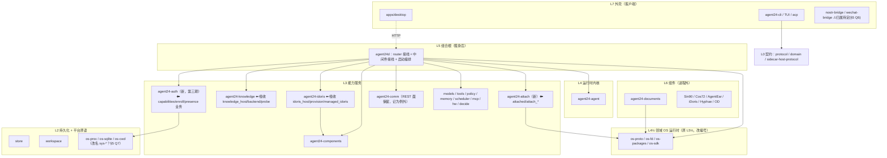

# Agent24 架构优化方案（草案）

> **进度（2026-11-04）**：预览版停发，主线转为组件整合与统一。Q1 已拍板 (b)（本文 Q1 的 (b)，不同于 PLAN-OD-NEXT F11.4 的 (b)）：Open Design 改由 `SidecarManager` 托管（设计见 [C8-SIDECAR-DESIGN.md](C8-SIDECAR-DESIGN.md)，实现 #1580，进行中）；正文里按 (a) 写的推荐（Q1 行、C1、C4、S1-6、S2-6）已逐行加注，依赖 Q1 的 `sidecar-host` 冻结与 S1-7 待重新评估。ADR-038 C1–C7 及评审遗留（#1570–#1575、#1577–#1579）已合入。第 0/1/2 期其余分片未开工，等 §5 其余问题拍板。

| 项 | 内容 |
|---|---|
| 日期 | 2026-11-04 |
| 基线 | `origin/main` @ `163dd2d3`（Merge #1573）。三份报告基于 `9865d7a0`（#1555，2026-11-03 10:32 +0700） |
| 输入 | R1 `R1-MODULE-MAP.md` + `R1-ROUTES-APPENDIX.md`（`origin/docs/arch-review-r1-module-map`）；R2 `R2-CONCEPT-INVENTORY.md`（`origin/docs/arch-review-r2-concept-inventory`）；R3 `R3-ADR-AND-DOCS.md`（`origin/docs/arch-review-r3-adr-docs`）（均在 `docs/architecture/review-2026-11-03/`，各自分支）；main 上的 `docs/architecture/README.md`、`docs/adr/README.md`、ADR-038、ADR-039、`docs/capabilities/REGISTRY.md` |
| 核对方式 | 只读：在 `163dd2d3` 的只读 worktree 里 grep / 读源码 / `git diff 9865d7a0..163dd2d3`；行数沿用 R1 的 `scripts/loc.py` 口径（脚本在 R1 分支）（非空、非注释、非测试）。**没有构建、没有跑测试** |
| 口径 | 报告与 main 冲突时以 main 为准，标「报告已过时」。`d/` = `rust/apps/agent24d/src/` |
| 性质 | 草案。只提方案与分片，不做决定；需拍板的集中在 §5 |

> 关于 #1554（comm 路径参数 500）：它的合并提交 `74f01270` 是 `9865d7a0` 的祖先（2026-11-03 10:31 合入），**三份报告写作时已包含它**，不属于「报告之后的变化」。基线之后真正新增的是 #1570–#1575（另有 #1556/#1557/#1566 只动桌面导出、OD helper、AGENTS.md）。

---

## 1. 一页结论

### 1.1 现状

- **依赖方向是健康的**：Rust 32 个 crate 的 normal / dev 依赖都无环，没有下层依赖上层（R1 §3.2）。问题不在 Cargo 图，而在**组合根和外壳里堆了业务**。
- **组件机制 v1 基本收口**：ADR-038 §4 的 C1–C7 已全部合入（C1/C1b/C3a/C3b 在报告前；C2 #1574、C4 #1572、C5 #1571、C6 #1570、C7 #1575 在报告后），`GET /api/v1/components` 覆盖 iDoris、Hyphae、attach、Documents、Knowledge、Open Design、领域 OS、进程内模块、MCP；`docs/capabilities/REGISTRY.md` 已建，并有漂移测试 `registry_lists_every_capability_id_the_components_emit`。**只剩 C8**（`ADR-038:331`）。
- **文档与 ADR 状态普遍落后于代码**：ADR-038 正文写到 r5、C2–C7 已标完成，状态行仍是「草案 r3」（`docs/adr/ADR-038-component-contract-v1.md:5`）；ADR-037 仍是「提议，批准前不派生产实现」（`docs/decision.md:1508`），而按它实施的 PR 已有 9 个以上（R3 §1.1）；`ARCHITECTURE-LAYERS.md` 依赖表仍写 `components | idoris`（第 79 行附近，main 上未改，最后修改 `e6ee1896` 11-01）。
- **agent24d 还在长**：非测试行 26,296（R1 §1.1）→ **27,915**（main，+1,619，主要是 `mcp.rs` 414、`knowledge_probe.rs` 555、`component_routes.rs` 728 与 `knowledge_host.rs` 637）。C2 的 Hyphae 探测放在了 `agent24-comm/src/hyphae_probe.rs`，是正确的方向；C5 的 Knowledge 探测却又落进了 agent24d。

### 1.2 最大的 5 个结构问题

| # | 问题 | 一句话证据 |
|---|---|---|
| P1 | **agent24d 组合根承载业务**，`server.rs` 2,725 行非测试，`serve()` 从 1893 行到 3420 行约 1,530 行一个函数 | R1 §4；main 上 `d/server.rs:1893`、函数结束于 `:3420` |
| P2 | **安全敏感逻辑有多份实现、宽严不一**：enroll 的代码签名要求比安装宽（`agent24-os-proc/src/lib.rs:249-262` 只要求字母数字、无 Developer ID OID；`agent24-components/src/sign.rs:178,187` 有严格版）；Team ID 在非 docs 文件里出现于 19 个文件；TS 侧 `daemon.json` 5 个解析器 | R1 §5.1 A3/A4、§5.4 D2；main 复核 |
| P3 | **ADR / 架构文档 / 跟踪文档三套状态源都不可信**：ADR 状态落后、编号冲突（日志 ADR-001–006 与 OD ADR-001–006、两份 ADR-016）、通讯 31 条决策无 ADR、跟踪文档散在 5 处以上 | R3 §0.2、§2、§3.A、§5.1 |
| P4 | **对外协议面有漂移且无约定**：`GET /approvals/{id}` 不在 OpenAPI（`protocol/openapi.yaml:1242` 下仍只有 `post`）；门禁只比路径；documents `_a24/*` 不在豁免表；sin90 10 个 op 在本仓无实现；命名风格混杂 | R1 §7；main `d/server.rs:1570-1572, 4120-4150` |
| P5 | **约 1.4 万行休眠代码 + 两套 sidecar 托管器**挡在 C8 前面：`agent24-sidecar-host` 12,177 行 + `-protocol` 1,662 行只有 Windows CI 编译；TS `SidecarManager`（353 行）只被测试导入；真正跑 OD 的是 `creative-serve-web.ts` | R1 §6.2、R2 I-11；main 复核 |

### 1.3 目标形态（一句话）

**agent24d 只剩「组合 + 路由接线 + 鉴权中间件接线 + 启动序列编排」；业务下沉到对应 L3 crate；组件机制以 ADR-038 r5 为唯一契约并宣告 v1 收口；文档侧以「ADR 索引（唯一发号）+ 三份带日期跟踪文档」为唯一状态源。** 原型阶段不追求一步到位，按 §4 分三期推进，每期都能独立停下。

---

## 2. 目标模块图

### 2.1 分层与要动的边



### 2.2 依赖调整表

| 动作 | 对象 | 从 → 到 | 新增边 | 依据 |
|---|---|---|---|---|
| **下沉** | iDoris 托管（`idoris_host.rs` 1,286、`idoris_host/provision.rs` 1,045、`managed_idoris.rs` 170） | agent24d → `agent24-idoris` | idoris → models（L3 内部） | R1 §4「成本最低」：已在 `d/lib.rs` 的 lib target 里，`provision.rs` 不依赖 `crate::` |
| **下沉** | Knowledge 宿主（`knowledge_host.rs` 637、`knowledge_backend.rs`、`knowledge_probe.rs` 555、`knowledge_store.rs` 212 未接线） | agent24d → `agent24-knowledge` | 无（knowledge 已有 `provider/host/`） | R1 §4；main 新增 `knowledge_probe.rs`（#1571） |
| **拆出** | attach 子系统（约 1,519 行） | agent24d → 新 `agent24-attach` | attach → os-proto、domain；需先抽 events / model_callback 的 trait | R1 §4：不能单独迁 `attach_registry`，也不宜并入 os-proto |
| **拆出（最后）** | 鉴权业务（约 4,900 行，含 `server.rs:1025-1418` 中间件） | agent24d → 新 `agent24-auth`；handler 与中间件接线留 agent24d | auth → os-proc | R1 §4、§9 #12，安全核心 |
| **拆文件不拆 crate** | `server.rs`：`serve()` 按子系统拆启动步骤；鉴权中间件移到 `capabilities/` | agent24d 内部 | — | R1 §4 server.rs 构成表 |
| **反转/去重** | os-proc 的签名要求改用 `components::sign::team_requirement` / `valid_team_id` | — | os-proc 不宜依赖 components（components 带 reqwest）。**建议把这两个纯函数下沉到 os-proc（或新 sys crate），由 components 反过来复用** | R1 §5.1 A3；`agent24-components/src/sign.rs:178,187` |
| **改编号** | L5½ → L4½（或「L5 之下的共用运行时」） | 文档 | — | R1 §3.1：被 L5 与 L6 共同依赖 |
| **冻结/移出** | `agent24-sidecar-host` + `-protocol` | 默认 workspace → 冻结（视 §5 Q1；**Q1 已拍板 (b)，见顶部，待重新评估**） | — | R1 §6.2、§9 #7 |
| **保留为例外** | `agent24-comm` 自带 axum REST 面 | 不动，在 LAYERS 文档里写成显式例外 | — | R1 §3.3 #1；comm 的 zero-run 依赖白名单（`agent24-comm/tests/comm_dependency_allowlist.rs`）让它下沉路由的收益很小 |

瘦身目标（第二期结束）：agent24d 非测试行从 27,915 降到约 22,000（减 iDoris ~2,500 + Knowledge ~1,800 + attach ~1,500）。第三期 auth 抽出后约 17,000–18,000。

---

## 3. 问题清单

### 3.1 已被 #1570–#1575 解决（或报告已过时）

| 报告条目 | 报告结论 | main 现状 | 证据 |
|---|---|---|---|
| R2 §3.1 C2、R3 §1.A.1.4 C2 | Agent24 侧不调用 `hyphae contract/health`，无 `degraded` | **已解决**（#1574）：spawn 前按锁握手，不兼容 `incompatible`/`contract_mismatch`；45 秒 health，连续 3 次失败 `degraded` | `rust/crates/agent24-comm/src/hyphae_probe.rs`（新增 941 行）；`d/component_routes.rs` `overlay_hyphae`；ADR-038:325 |
| R2 C4、R3 C4 | 只有通用 attach 覆盖 | **已解决**（#1572）：清单 version、协议失配 `incompatible`（`component_contract_mismatch`）、超时发 `$/cancelRequest` | `d/component_routes.rs:416-417`；`agent24-os-proto/src/attach_mux.rs`；ADR-038:327 |
| R2 C5、I-24；R3 C5 | Knowledge 有 binding 就 `ready`，无探测 | **已解决**（#1571）：`/system/capabilities` 探测，TTL 30s、singleflight | `d/knowledge_probe.rs`；ADR-038:328。遗留：不探测 §8 就绪（ADR 自述） |
| R2 C6；R3 C6 | Documents `provides` 为空 | **已解决**（#1570）：`rust/apps/agent24-documents/component.json` 编译进 agent24d | `d/component_routes/documents_catalog.rs` |
| R2 C7、I-15；R3 C7、D9 | `REGISTRY.md` 不存在；领域 OS/MCP 不在 `/components` | **已解决**（#1575） | `docs/capabilities/REGISTRY.md`；`d/mcp.rs`（+1,048 行含测试） |
| R2 P3 风险「`DomainOsManifest` 是 `deny_unknown_fields`，加 `provides` 要升 `MANIFEST_SCHEMA_VERSION`」 | 报告已过时 | `provides` 作为可选字段加入，`MANIFEST_SCHEMA_VERSION` 仍为 1，旧清单省略即可 | `rust/crates/agent24-domain/src/lib.rs:418` 及 #1575 diff |
| R2 I-9 部分、P4 | OS 包与进程内模块无 Form 可用 | **事实上已定**：都记 `resident`，用 host-only `detail.binding = in_process / package` 区分；`Form` 枚举未加变体 | `REGISTRY.md`「领域 OS」节；`agent24-components/src/state.rs:32-45` |
| R2 I-3、R3 X14、ADR-038 §7.11 | Hyphae 锁里 `stop_grace_ms` 没人读 | **已解决**（#1573）：按组件生效，超出全局预算截断并记日志。**iDoris 锁的同名字段仍未用**（ADR-038 §7.11 修订后原文） | `d/comm_routes.rs:85, 266, 292` |
| R2 C3b 残项 | OD `headlessPhase` 离开 installed 的残留状态 | **已解决**（#1573） | `apps/desktop/src/main/creative-serve-web.ts`、`open-design-report.ts` |
| R3 §1.A.1.5 #7、#8 | `component_contract_mismatch`、`degraded` 零产出 | **部分解决**：attach、Knowledge 有 `component_contract_mismatch`；Hyphae 有 `degraded`/`incompatible`（reason 用 `contract_mismatch`，与统一码不同名）；**iDoris 失配仍映射 `Failed`** | `d/component_routes.rs:142-156`（`from_idoris` 无 Incompatible 分支） |
| R2 I-23 | 本地模型页每秒只读 `/idoris/status` | 报告已过时（R3 判断更准）：三页都 import `componentApi`；IdorisPanel 每秒同时读 `/idoris/status`（操作细节）和 `/components`（状态） | `apps/desktop/src/renderer/components/idoris/IdorisPanel.tsx:3, 61-99` |
| R1 §2/ARCH-LAYERS 依赖反转 | components ← idoris 已反转 | 代码已反转（#1539，报告前）；**文档仍未改**，见 §3.2 A3 | — |
| #1554 | — | 报告前已合入，报告已覆盖 | `74f01270` 是 `9865d7a0` 的祖先 |

### 3.2 待办

严重度：高 = 安全判断或数据；中 = 多套机制或误导设计；低 = 文档或命名。

#### A. 文档与 ADR

| # | 问题 | 证据 | 影响 | 建议 | 严重度 |
|---|---|---|---|---|---|
| A1 | ADR-038 状态行「草案 r3」落后正文（r4/r5、C2–C7 已完成）；正文自相矛盾 16 处（schema 1 可读、`executables` 可选、`notarized` 等），仅 C 表与 §7.11 有更新 | `ADR-038:5`；R3 §1.A.1.5 | 新人按旧句设计 | 出 r5 订正稿后改「已接受」（S0-2） | 中 |
| A2 | ADR-037 状态矛盾：`decision.md:1508`「提议」vs `CORE-5-MIGRATION-GUARD-DESIGN.md:200`「已于 #1249 接受」 | R3 §0.2 #1；main 复核 `decision.md:1508` | 无法判断哪些已定 | 拍板后订正（S0-1） | 中 |
| A3 | `ARCHITECTURE-LAYERS.md` 依赖表错 4 行（worker、idoris、components）；§7 第 10 条过期；L5½ 编号误导；unsafe 边界只写 2 个 crate、实际 4 个；node-daemon 只覆盖 4/124 op | R1 §8、R3 §4.1；main 未改（`e6ee1896`） | 架构文档不可信 | 重新生成（S0-5） | 中 |
| A4 | 其余 ADR 状态失真：MEMORY-P1、R05（已有外审 APPROVE 仍写 PROPOSED）、028、KB-01、docs/ADR-016；「已接受」但被取代的 001/006/012–016/024；从未实现的 005/008/009/021/DOC-03 | R3 §1.1、§1.B.6.4 | 同上 | 一次性订正（S0-1），索引加「事实取代 / 搁置」两档 | 低 |
| A5 | 编号冲突：日志 ADR-001–006 vs OD ADR-001–006（137 行引用）；两份 ADR-016；初稿 ADR-040–044 与终稿错位。**新增**：R3 建议通讯 ADR 用 ADR-044，但 `docs/research/deepseek-superagent/SUPERAGENT-EVOLUTION-2026-11-01-codex-astra.md:109,145` 已有一份「ADR-044」 | R3 §2；main grep | 引用歧义 | 别名方案（S0-3），Codex 稿编号记 `DRAFT-C04x` | 低 |
| A6 | **通讯无 ADR**：31 条已定决策散在 COMM-HYPHAE / F4 / PR；3 处实质矛盾（X1 随包 vs 按需、X7 两套 Nostr 身份、X11 入站执行入口） | R3 §3.A；`docs/architecture/README.md:56`「暂无独立 ADR」 | 后续 COMM-FRIENDS、ADR-041 没有上位依据 | 先拍板 X1/X7/X11，再写 ADR（S0-4） | 中 |
| A7 | 无统一跟踪文档：`tasks.md` 自称唯一权威但 24 条过期；`progress.md` 停在 09-28；`docs/tracking/` 只有 `2026-10-26/SOURCE-ADR-037-facts.md` | R3 §5.1；`docs/architecture/README.md:81`；main `ls docs/tracking` | 状态散在 5 处以上 | 三份带日期文档（S0-6） | 中 |
| A8 | `REGISTRY.md` 的 `documents` 行「契约来源」写 `domain-os.yml`，而 C6 的清单在 `rust/apps/agent24-documents/component.json`（#1570） | `docs/capabilities/REGISTRY.md:14` | 小的新漂移 | 随 S0-2 一起改 | 低 |
| A9 | 缺 ADR 的其他决策：iDoris 由 agent24d 托管（O3）、Knowledge 宿主接口 KB-HOST-01（正文只在 issue #1085，O9）、SPEC-EDITIONS（O18）；ADR-035 已被 IL-13 部分取代未标 | R3 §3.B；R2 I-13 | 安全边界无仓内依据 | O9 优先（凭据边界）；O3、O18 可后置 | 低–中 |
| A10 | ADR-038 D6：CLI 超时正文写「先 SIGTERM，2 秒后 SIGKILL」，代码直接 SIGKILL 进程组 | `agent24-comm/src/runner.rs:269`；R3 §1.A.1.5 #11 | 正文与代码不符 | §5 Q13 二选一 | 低 |
| A11 | ADR-038 D7：`requires` 只被解析和展示（host `detail`），没有任何授权路径读取 | main grep：`d/component_routes.rs:581`、`documents_catalog.rs:185-192` 仅输出 | `requires` 是摆设 | r5 标「待接线（C9）」，不在 v1 做 | 低 |

#### B. 对外协议面

| # | 问题 | 证据 | 影响 | 建议 | 严重度 |
|---|---|---|---|---|---|
| B1 | `GET /api/v1/approvals/{id}` 已注册、不在 OpenAPI | `d/server.rs:1572`；`protocol/openapi.yaml:1242-1244` 只有 `post` | api-client 缺类型；漂移未被拦住 | 补 OpenAPI + 重新生成 api-client（S1-1） | 中 |
| B2 | 漂移门禁只比路径不比方法 | `d/server.rs:4275` `kernel_routes_and_openapi_paths_have_no_unlisted_drift`；同文件 `registered_routes_match_the_operation_catalog` 已是方法级（R1 §7.1） | 方法级漂移漏网 | 门禁改按「方法 + 路径」（S1-1） | 中 |
| B3 | documents `POST /_a24/tools/{op}`、`/_a24/authorization/revoked` 不在 OpenAPI、不在豁免表，门禁不扫 documents 源码；route_policy 统一给 Everyday | `rust/apps/agent24-documents/src/lib.rs:204-205`；`MODULE_SURFACE_PATHS`（`d/server.rs:4135-4150`）无 `_a24`；R1 §7.1 | 内核↔模块内部通道没有登记；Everyday 级是否合适未经审视 | 列入豁免表并注明「模块内部通道」，另核 `_a24/*` 是否应只允许内核调用（S1-1） | 中 |
| B4 | sin90 10 个 op 写在本仓 OpenAPI，实现在外仓 `iDoris-ai/Sin90`，无跨仓契约测试 | `protocol/openapi.yaml:2037-2252`；`MODULE_SURFACE_PATHS` 注释「M2-07 records whether they stay here」 | 契约与实现分居两仓，静默漂移 | §5 Q4 拍板：迁出到 Sin90 仓 / 保留 + 跨仓契约测试 / 保留并标「外部契约」 | 低–中 |
| B5 | 路由命名不统一：「模块」类资源分在 5 个前缀（`/os`、`/attached`、`/module-consents`、`/module-approvals`、`/components`）；单复数、`run_now` 下划线、动词路径、`{id}`/`{name}`/`{module}` 混用；叠词 `/documents/documents` | R1 §7.2 | 新接口继续发散 | 立约定只约束新路由（S0-7），旧路由冻结 | 低 |
| B6 | `/comm/install` 实现在 agent24d、前缀属 comm，`unconfigured_router` 下没有该路由 | `d/comm_routes.rs:721, 757-763`；R1 §7.3 | 未配置时无法经 API 安装？（R1 标未核实） | 先核实预期，再决定是否补到 `unconfigured_router`（S1-1 附带） | 低 |

#### C. 组件机制收尾

| # | 问题 | 证据 | 影响 | 建议 | 严重度 |
|---|---|---|---|---|---|
| **[已按 Q1 (b) 改道：C8 由 #1580 实现]** C1 | **C8 未完成**：OD 由 `CreativeServeWeb` 托管；`SidecarManager`（TS）与 `agent24-sidecar-host`（Rust）都不在产品路径 | `ADR-038:63, 174, 331`；`apps/desktop/src/main/creative-serve-web.ts:7` 只 import `SidecarState` 类型；`sidecar-manager.ts` 只被测试引用 | ADR-038 v1 无法宣告收口；两套托管器维护成本 | §5 Q1；推荐「把 CreativeServeWeb 定为 v1 sidecar 绑定」（S1-6） | 中 |
| C2 | iDoris 契约失配映射 `Failed` 而非 `incompatible`；契约阈值三处不一致（锁 ≥1.1；网关 `contract_version_accepted` ≥1.0.1；supervisor 写死 `major != 1`） | `d/component_routes.rs:142-156`；`agent24-models/src/idoris.rs:480-492`；R2 I-20、R1 B5 | 非托管 iDoris 1.0.x 被网关接受、托管路径拒绝 | 网关改用锁里的 contract；`from_idoris` 加 Incompatible（S1-4） | 中 |
| C3 | Hyphae 进程态 `starting`、`backoff`、`locked` 仍一律 `failed`（带 reason） | `d/component_routes.rs:190-197` `from_hyphae` 的 `other =>` 分支 | `locked`（口令未解锁）显示为故障；与 D5 的 `starting` 不符 | `starting → Starting`；`locked` 语义见 §5 Q14（S1-4） | 低–中 |
| **[Q1 (b) 下归属待定：随 #1580 后续再定]** C4 | Rust `from_open_design` / `from_sidecar` 无生产调用，且与 TS `mapInstallState` 结论不同 | `agent24-components/src/state.rs:114,130`；R1 E6 | 两份「权威映射」互相矛盾 | 删 Rust 版或改为 TS 映射的 fixture 对照（随 S1-6） | 低 |
| C5 | **OS 包完整性**：只对 `domain-os.yml` 字节做摘要，可执行文件不哈希不验签；Sin90/Cos72 是外仓二进制，不在 ADR-038 D1 任何免锁豁免里 | `agent24-os-packages/src/discovery.rs:261-266`；R2 I-2 | 外仓二进制无校验（最实的安全缺口） | §5 Q15；推荐先「包内全文件清单摘要，只记录不拒绝」一版 | 高 |
| C6 | 下载器 / 校验 Rust 与 TS 两套；OD pin 写 4 份 | R1 §5.3 C1/C2、B8/B9；R2 I-1、I-7 | 安全基线漂移；#1555 式多处手改 | v1 只做 OD pin 单源（S1-5）；合并下载器不做（§6） | 中 |
| C7 | Knowledge 工具以 `"builtin"` 身份注册，不走 K1 逐工具同意 | `d/knowledge_tools.rs:88`；R2 I-6 | 按 ADR-039 它是能力，却以本体身份出现 | §5 Q16 | 低 |
| C8 | iDoris 状态目录写死 `$HOME/Library/Application Support/Agent24/idoris`，不认 `AGENT24_DATA_DIR`，Linux 路径不对 | `rust/crates/agent24-idoris/src/install.rs:22-25` | 隔离测试漏写真实 HOME | 随 S2-2 修；已装用户需迁移或仅 Linux 改 | 中 |

#### D. agent24d 瘦身

| # | 问题 | 证据 | 建议 |
|---|---|---|---|
| D1 | `server.rs` 2,725 行非测试；`serve()` ~1,530 行；鉴权中间件 ~390 行（`:1025-1418`） | R1 §4；main `d/server.rs:1893-3420` | S2-1 拆文件 |
| D2 | iDoris 托管 ~2,500 行在组合根；provision 路径绕过依赖注入（R1 C5） | R1 §4、§5.3 C5 | S2-2 |
| D3 | Knowledge 宿主 ~1,800 行（含 #1571 新增探测）在组合根；`knowledge_store` 生产零调用 | `d/main.rs:51-52` `#[allow(dead_code)] mod knowledge_store` | S2-3 |
| D4 | attach 子系统 ~1,500 行 | R1 §4 | S2-4 |
| D5 | 鉴权 ~4,900 行 | R1 §4 | S2-5（第三期） |
| D6 | 「SIGTERM → 等 → SIGKILL」7 份实现 | R1 §5.6 F1 | S2-6 |

#### E. 安全重复

| # | 问题 | 证据 | 建议 | 严重度 |
|---|---|---|---|---|
| E1 | enroll 签名要求比安装宽 | `agent24-os-proc/src/lib.rs:249-262` vs `agent24-components/src/sign.rs:178-192` | S1-2 统一；dev 构建旁路见 §5 Q2 | 高 |
| E2 | Team ID 多处写死，代码常量与锁文件无一致性检查；main 上新增 `apps/desktop/scripts/open-design-mac-release.mjs:30` `EXPECTED_TEAM_ID` | main `git grep -l HYAP444FN9` 非 docs 19 个文件（含测试） | S1-2：Rust 一处常量 + 测试校验两份锁、脚本与常量一致 | 高 |
| E3 | `daemon.json` TS 5 个解析器，`auth_mode` 语义不同；两个 bridge 忽略 `auth_mode`，缺 token 发空 token | R1 §5.4 D2/D3；main `backend-manager.ts:291-298, 410-421`；bridges 无 `auth_mode` | S1-3 | 高 |
| E4 | 渠道桥只能用 legacy 全权 token（ADR-038 D7 禁止组件持有） | R2 I-12；`packages/nostr-bridge/src/config.ts:112-134` | 归属先拍板（§5 Q6）；产品化前禁止 legacy token | 高（限开发态） |

#### F. 外壳与 CLI

| # | 问题 | 证据 | 建议 |
|---|---|---|---|
| F1 | 桌面有业务、CLI 无入口：Knowledge 绑定/凭据、presence、OD 下载启动、Comm 私钥备份恢复（CLI `CommIdentityAction` 只有 List/Create/Use） | R1 §5.6 G2；AGENTS.md:26；基线后 `agent24-cli` 无改动 | §5 Q5 |
| F2 | 桌面与 CLI 各自托管 daemon | R1 G1 | 随 Q5，不单独排期 |

---

## 4. 分片计划

派给谁：**Remote** = 云端 Remote 会话（文档、分析、大块机械重构）；**Grok** = 本机 Grok 写码；**拍板** = 需要 jason 先定。所有写码片按现有规矩：PR 前 Codex 挑战（mini 只读）、安全或钱相关 Opus 评审，其余 Sonnet 评审；评审只修真 bug，设计最多 1 轮。

规模：S < 300 行改动；M 300–1,000；L > 1,000（以移动为主的 L 可按层拆 stacked PR，但以少为好）。

### 4.1 第 0 期：文档与 ADR 收口（不碰代码）

| 片 | 目标 | 涉及 | 规模 | 依赖 | 验收标准 | 风险 | 派给 |
|---|---|---|---|---|---|---|---|
| **S0-1** ADR 状态一次性订正 | 037、MEMORY-P1、R05、028、KB-01（拆 01a/01b）、docs/ADR-016、029/033 状态行、取代/废弃/搁置三档 | `docs/decision.md`、`docs/adr/*.md`、`docs/adr/README.md`、`docs/knowledge/ADR-KB-01-*.md`、`docs/ADR-016-*.md` | M（纯文档） | Q8、Q9 拍板 | 索引每行状态与文首一致；`CORE-5-…:200` 与 `decision.md:1508` 不再矛盾；每个「取代」写明取代者 | 低 | 拍板 → Remote |
| **S0-2** ADR-038 r5 订正稿 | §7.1–§7.11 回写 D2/D2a/D4/D5；删自相矛盾旧句；C2–C7 状态与代码对齐；D6 按 Q13；D7 标「待接线」；C8 按 Q1 改写；`REGISTRY.md` documents 行改指 `component.json`；状态改「已接受」 | `docs/adr/ADR-038-component-contract-v1.md`、`docs/capabilities/REGISTRY.md` | M | Q1、Q13 | R3 §1.A.1.5 的 16 条逐条有处置；`registry_lists_every_capability_id_the_components_emit` 仍绿 | 低（REGISTRY 改动会被漂移测试守住） | Remote |
| **S0-3** 编号别名 | OD → `ADR-OD-00x` 文件头；docs/ADR-016 → `ADR-016P`；初稿 → `DRAFT-F04x`；Codex 稿 → `DRAFT-C04x`；索引写明「唯一发号处，下一号 ADR-044」 | 6 个 OD ADR 头、ADR-026 6 行、`protocol/module.schema.json:5`、5 个初稿头、`SUPERAGENT-EVOLUTION-2026-11-01*.md` | S | Q10 | 不改任何文件名，`git grep 'ADR-00[1-6]-[A-Z]'` 链接数不变（23）；索引有发号规则 | 低 | Remote |
| **S0-4** 通讯 ADR-044 草案 | 按 R3 §3.A.3 提纲写；吸收 C01–C31；X2–X5/X8/X9/X14–X16 列为订正待办 | 新 `docs/adr/ADR-044-communication.md`；`docs/architecture/README.md:56` | M | **Q12（X1/X7/X11）必须先定**；S0-3 | 每条决策有出处 file:line；X1/X7/X11 有结论；与 ADR-041 边界写清 | 中：可能与 ADR-041 重叠 | 拍板 → Remote |
| **S0-5** ARCHITECTURE-LAYERS 重新生成 | 依赖表由 `cargo metadata` 重生成；§7 第 9、10 条更新；L5½ 改编号或加注；os-proc/os-sqlite/documents-client 归层；unsafe 边界补 4 个 crate；node-daemon 改称「开发用 mock，覆盖 4/124」；comm 写成显式例外；agent24d 体量引用本方案 | `docs/ARCHITECTURE-LAYERS.md`、`docs/architecture/EVOLVABILITY-ASSESSMENT-2026-11-01.md`（加附注） | M | 无 | 依赖表与 `cargo metadata --no-deps` 输出逐行一致（附生成脚本或命令） | 低 | Remote |
| **S0-6** 三份跟踪文档首期 | `docs/tracking/2026-11-xx/{ARCH-AND-PLAN,MILESTONES-AND-TASKS,PROGRESS}.md`，按 R3 §5.2 骨架；旧 `tasks.md`/`progress.md`/`roadmap.md` 文头加「历史，见 tracking」 | `docs/tracking/`、`docs/agent/*.md`、`docs/architecture/README.md:79-84` | M | Q11 | 三份都带数据来源 / 生成方式 / HEAD sha；PROGRESS §1 由 `git log --merges` 生成；本方案 §4 的分片进 MILESTONES | 低；要持续维护才有价值 | Remote（之后每周值班代理） |
| **S0-7** 路由命名约定 | 一页约定：复数集合、动作子资源写法、参数名、`{name}` vs `{id}`、模块类资源前缀；只约束新路由，旧路由冻结并列出例外 | 新 ADR（或 SPEC-002 附录） | S | Q4 | 约定可被一个门禁测试检查（至少：新增路径不得含下划线、参数名在白名单内） | 低 | 拍板 → Remote |
| S0-8（可后置） | KB-HOST-01 落成 ADR-KB-02；iDoris 托管 ADR（O3）；ADR-035 标部分取代 | `docs/knowledge/`、`docs/decision.md` | S–M | S0-3 | 仓内有凭据交接与授权归属的正文 | 低 | Remote |

### 4.2 第 1 期：低风险结构调整

| 片 | 目标 | 涉及 | 规模 | 依赖 | 验收标准 | 风险 | 派给 |
|---|---|---|---|---|---|---|---|
| **S1-1** OpenAPI 漂移收口 | 补 `GET /approvals/{id}`；门禁改「方法 + 路径」；`_a24/*` 进豁免表（注明内部通道）；sin90 按 Q4 处置；核实 `/comm/install` 在 `unconfigured_router` 缺失是否预期 | `protocol/openapi.yaml`、`packages/api-client`（重新生成）、`d/server.rs` 测试段、`agent24-documents` 路由扫描 | S | Q4（仅 sin90 部分） | 故意删掉一个方法时门禁变红（正对照）；api-client 生成物无其他差异 | 低 | Grok |
| **S1-2** 签名要求与 Team ID 单源 | os-proc 的 requirement 与 components 同严；Team ID 收成一处 Rust 常量，测试校验两份锁、`scripts/sign-cli-mac.sh`、`release-mac.sh`、`open-design-mac-release.mjs`、`package.json` 与之一致 | `agent24-os-proc`、`agent24-components/src/sign.rs`、`d/enroll_endpoint.rs`、`d/capabilities/first_party.rs`、脚本 | M | **Q2**（dev 构建旁路） | 用 Developer ID 以外证书签名的二进制 enroll 失败（测试）；改任一处 Team ID 一致性测试变红 | 中：收紧后本地开发 CLI 可能 enroll 失败 | 拍板 → Grok（Opus 评审） |
| **S1-3** TS `daemon.json` 单一解析器 | `@agent24/data-dir` 提供 `readDaemonState`，复刻 Rust `state_file.rs` 的 validate 与 `auth_mode` 规则；desktop、两个 bridge、documents-accept 改用；bridge 的 `RunStatus` 改用 api-client 生成类型 | `packages/data-dir`、`apps/desktop/src/main/backend-manager.ts`、`packages/*-bridge/src/{config,agent24}.ts`、`packages/documents-accept/src/client.ts` | M | 无（bridge 行为变化需在 PR 说明） | 共享 fixture 覆盖 legacy / capabilities / 未知 `auth_mode` / 缺 token；bridge 在 capabilities 模式下明确报错而非发空 token | 低–中 | Grok（Opus 评审：鉴权语义） |
| **S1-4** 状态映射与契约阈值残项 | `from_idoris` 加 Incompatible（`component_contract_mismatch`）；网关 `contract_version_accepted` 改读锁的 contract；supervisor 去掉写死 `major != 1`；Hyphae `starting → Starting`，`locked` 按 Q14；Hyphae 失配 reason 是否统一为 `component_contract_mismatch` 一并定 | `d/component_routes.rs`、`agent24-models/src/idoris.rs`、`agent24-idoris/src/supervisor.rs`、`agent24-idoris/src/lib.rs` | S–M | Q14 | 1.0.x iDoris 在托管与非托管两条路径结论一致（测试）；`/components` 不再出现 `failed/starting` | 低 | Grok |
| **S1-5** OD pin 单一来源 | 一份 `open-design.lock.json`（或 JSON pin），4 个脚本、`release-desktop.yml` 3 处、`creative-serve-web.ts:88` 的 `OPEN_DESIGN_PIN_VERSION` 都读它，或加一致性测试 | `apps/desktop/scripts/*open-design*`、`.github/workflows/release-desktop.yml`、`creative-serve-web.ts` | S | 无 | 改 pin 只需改一个文件；漏改时测试变红 | 低 | Grok |
| **[作废：Q1 已拍板 (b)，改为 #1580]** **S1-6** C8 收尾（推荐方案，见 Q1） | ADR-038 C8 改写为「`CreativeServeWeb` 即 v1 的 sidecar 绑定（ADR-OD-004：Electron main 是唯一 owner）」；删 `SidecarManager` 及其测试（`CreativeServeWeb` 已实现 `SidecarState` 契约）。**不改 OD 的停止语义**：60s 超时后拒绝强杀是有意设计（`creative-serve-web.ts:87, 613`「refusing an owner-only force kill」），只在 ADR 里写明这一例外；删 Rust `from_open_design`/`from_sidecar` 死映射；`agent24-sidecar-host` 按 Q1 冻结 | `apps/desktop/src/main/{creative-serve-web,sidecar-manager,sidecar-contract}.ts`、`agent24-components/src/state.rs`、`ADR-038` §4 | S–M | **Q1**；S0-2 同步改文 | ADR-038 §4 C1–C8 全部「已完成」；仓内只有一份 OD 状态映射（TS `mapInstallState`）；桌面 `pnpm` 测试全绿 | 低–中：只删未用代码和改文，不动产品路径 | 拍板 → Grok |
| **S1-7** 休眠代码收窄 | `agent24-worker` 移出默认 members 或标 experimental；`knowledge_store` 删或 feature-gate（随 S2-3 也可）；store allocation / terminal 休眠链 feature-gate（**先和 workspace G 系列计划对齐，不删**）；收窄过宽的 `allow(dead_code)`；`agent24-sidecar-host` 按 Q1 处理 | `rust/Cargo.toml`、`agent24-store/src/lib.rs`、`d/main.rs`、`agent24-workspace` | M | Q1 | `cargo build --workspace` 时间可见下降；`dead_code` 告警重新有意义（去掉 allow 后无新告警或已逐条处置） | 低–中：误删未来切片的底座 | Grok |
| S1-8（可选） | `os-proc/os-sqlite/os-cwd/os-fd` 改名 `agent24-sys-*` 或合并 | 4 个 crate 及消费者 | M（机械） | **Q7** | 编译通过；`sys-*` 恰为全部允许 `unsafe` 的 crate | 低，收益也低 | 拍板 → Remote（机械改名） |

### 4.3 第 2 期：大重构（agent24d 瘦身）

前置：第 0 期 S0-5 完成（新边界先写进文档）；Q3 拍板。每片先移动、后修行为，**同一 PR 不混**。

| 片 | 目标 | 涉及 | 规模 | 依赖 | 验收标准 | 风险 | 派给 |
|---|---|---|---|---|---|---|---|
| **S2-1** 拆 `server.rs` | `serve()` 拆成按子系统的启动步骤函数（docked、iDoris、workspace、领域 OS、comm、MCP……），顺序不变；鉴权中间件移到 `capabilities/middleware.rs`；health/shutdown/mint/revoke handler 移出 | `d/server.rs` 及新文件 | L（移动为主） | Q3 | `serve()` < 300 行；现有启动黑盒测试（`tests/capability_startup.rs`、`docked_startup.rs` 等）全绿；`src.find("pub async fn serve(")` 这类源码断言测试同步更新 | 中：启动顺序隐含依赖 | Remote（机械）+ Grok 收尾 |
| **S2-2** iDoris 托管下沉 | `idoris_host*`、`managed_idoris` 迁入 `agent24-idoris`；routes 留 agent24d；顺带修 provision 绕过依赖注入（R1 C5）；D1b 状态目录按 Q3 附带决定 | `d/idoris_host*.rs`、`d/managed_idoris.rs`、`agent24-idoris` | L（移动为主）+ S（修复） | S2-1 之后最顺（减少冲突），也可并行 | agent24d 减 ~2,500 行；`agent24-idoris` 自身测试覆盖原用例；D1b 若改，需迁移测试 | 低–中 | Grok |
| **S2-3** Knowledge 宿主下沉 | `knowledge_host/backend/probe/store` 迁入 `agent24-knowledge`；决定 `provider/`（~4,100 行）接线或冻结 | `d/knowledge_*.rs`、`agent24-knowledge` | L | Q3；**AGENTS.md：凭据类须等 APPROVE** | agent24d 减 ~1,800 行；C5 探测测试原样通过 | 中：凭据路径 | Grok（Opus 评审） |
| **S2-4** attach 抽 crate | 新 `agent24-attach`；先抽 events / model_callback 需要的 trait | `d/attached*.rs`、`d/attach_*.rs`、`d/agentear_timings.rs` | L | S2-1 | agent24d 减 ~1,500 行；C4 用例（失配、取消）原样通过 | 中 | Grok |
| **S2-5** 鉴权抽 `agent24-auth` | capabilities / enroll / presence 业务下沉，handler 与中间件接线留 agent24d | `d/capabilities/*`、`d/enroll_*.rs`、`d/presence_desktop.rs` | L | S1-2、S2-1；建议排在最后 | agent24d 再减 ~4,000 行；enroll / presence / mint 全部黑盒测试通过 | **高**：安全核心 | 拍板 → Grok（Opus 评审，外审 APPROVE） |
| **[注：Q1 (b) 后 OD 停止语义改为 TERM→15s→SIGKILL 整组，见 C8 设计]** **S2-6** 进程组终止原语 | Rust 一个 `kill_group_gracefully`（放 os-proc / sys），os-proto、comm、idoris、sidecar-host 共用；TS 一个，backend-manager 与 creative-serve-web 共用（是否强杀作为参数；OD 现为 TERM→15s→SIGKILL 整组） | 5 个 Rust crate、3 个 TS 模块 | M | #1580（C8，OD 停止语义已定；原 S1-6 作废）；Q13 | 同一组回收 / 超时 / 僵尸测试跑在共用实现上；各调用点超时值显式传入 | 中：统一会改变行为 | Grok |
| S2-7（按 Q5） | CLI 补齐：`knowledge` 绑定/凭据、`comm identity export/import` | `agent24-cli` | M | Q5 | release 用例可走 CLI | 中 | 拍板 → Grok |

### 4.4 依赖顺序一览

```
第 0 期（可并行）：S0-3 → S0-4；S0-1；S0-2；S0-5；S0-6；S0-7
                     ↑Q12            ↑Q8/Q9 ↑Q1/Q13      ↑Q11 ↑Q4
第 1 期：S1-1、S1-3、S1-4、S1-5 可立即并行（最多 3 个 Grok 并发）
         S1-2 等 Q2；~~S1-6 等 Q1~~（作废，见 #1580）；S1-7 等 Q1
第 2 期：S2-1 → S2-4、S2-5；S2-2、S2-3 可与 S2-1 错开；S2-6 在 #1580 后（原 S1-6 作废）；S2-5 最后
```

---

## 5. 需要 jason 拍板的问题

合并了 R1 的 7 问、R2 §5 的 7 问、R3 §0.3 的 Q1–Q8，去重并按 main 现状更新。每条给推荐。

| # | 问题 | 选项 | 推荐 | 来源 |
|---|---|---|---|---|
| **[已拍板 (b)，2026-11-04]** **Q1** | **C8 与 sidecar 路线**（含「sidecar 线协议是否冻结」） | (a) 把 `CreativeServeWeb` 定为 v1 sidecar 绑定，ADR-038 C8 就此完成；TS `SidecarManager` 删或并入；Rust `sidecar-host` + `-protocol` 冻结，移出默认 members，只留 Windows CI 编译；线协议冻结在当前 v1 不再演进 (b) 把 `CreativeServeWeb` 重构到 `SidecarManager` 上，再迁 OD (c) 接入 Rust `sidecar-host` 作为桌面托管器 | **(a)**。ADR-OD-004 已定 Electron main 是唯一 owner，产品路径已稳定；(b)(c) 是为一个组件重写托管器，原型阶段不值。Knowledge Lite 真要 sidecar 时再解冻 | R1 Q1、R2 Q5、I-11 |
| **Q2** | 签名收紧后 dev 构建怎么 enroll | (a) 只认 `test-enrollment` feature（`rust/apps/agent24d/Cargo.toml:11`），release 构建不含 (b) 加环境变量 `A24_ENROLL_DEV_TEAM_ID`，仅 debug 构建生效 (c) dev 构建也用 Developer ID 签名 | **(a)**，若 feature 覆盖不了日常 `cargo run` 再加 (b) 且限 `debug_assertions` | R1 Q2 |
| **Q3** | **agent24d 瘦身边界** | (A) 只拆文件不拆 crate (B) 三刀下沉：iDoris → idoris、Knowledge → knowledge、attach → 新 crate；auth 暂留 (C) B + auth 抽 crate | **(B)**，auth 等 S1-2 落地、CORE-2 稳定后再议。边界规则：「状态机、存储、协议帧下沉；axum handler、中间件接线、启动编排留在 agent24d」 | R1 Q3 |
| **Q4** | **路由命名约定 + sin90 的 10 个端点** | 约定：(a) 只约束新路由、旧路由冻结 (b) 趁 v1 统一改名（wire 不兼容）。sin90：(i) 迁到 Sin90 仓，本仓只留豁免 (ii) 留本仓 + 跨仓契约测试 (iii) 留本仓并标「外部契约，实现以 Sin90 为准」 | **约定选 (a)；sin90 选 (iii)**，等 Sin90 进入活跃开发再升 (ii)。顺带定 `_a24/*` 为「模块内部通道」进豁免表 | R1 Q4、§7.3 |
| **Q5** | CLI 与桌面的能力差 | (a) 按 AGENTS.md:26 逐项补 CLI（Knowledge、Comm 备份恢复先补） (b) 只补 release 用例必需的 (c) 修订 AGENTS.md，承认部分能力只在桌面 | **(b)**：先补 Comm 私钥备份恢复和 Knowledge 绑定（可被 CLI 自测），OD 下载与 presence 留桌面并在 AGENTS.md 写明例外 | R1 Q5 |
| **Q6** | 两座 bridge 的归属 | (a) 定为「渠道能力」，纳入组件机制，按组件发 token (b) 定为开发工具，不进产品，文档标明只用 legacy (c) nostr-bridge 并入 comm（入站经 ADR-041），wechat-bridge 维持开发工具 | **(c)**，与 Q12 的 X7（身份统一）一起定；在定之前产品构建禁止 bridge 用 legacy 全权 token | R1 Q6、R2 I-12、R3 X7 |
| **Q7** | `os-*` 前缀改名 | (a) 原语类改 `agent24-sys-*` (b) 合并成一个 `agent24-sys` (c) 不改，文档里说明 | **(c)**，S0-5 在文档里写清两种 os；等有别的理由动这些 crate 时再顺手改 | R1 Q7 |
| **Q8** | ADR 状态一次性订正 | 按 R3 §1.1 全部采纳 / 逐条审 | **全部采纳**：037 → 已接受（决策 1–5，决策 6 待遥控设计）；038 → r5 后已接受；MEMORY-P1、R05 → 已接受（设计）；028 → 收口段为正文；KB-01 拆 01a 已接受 / 01b 提议；docs/ADR-016 → 被替代；005/008/009/021 → 废弃；DOC-03 → 搁置（待 #692） | R3 Q1、Q7 |
| **Q9** | ADR-040–043 怎么定 | 按 R3 建议 / 继续挂提议 | **按 R3**：040 接受为设计约束（C7 已完成，阻塞已解除，`requires` 非空可用）；041 拆 041a/041b；042 先接受 D3、D4 边界；043 先接受 D1 + D3（`running_jobs`/`budget`），打破与 042 的循环 | R3 Q2 |
| **Q10** | 编号方案 | 只加别名不改文件名 / 改文件名 | **只加别名**；新号从 ADR-044 起，ADR 索引是唯一发号处；Codex 稿里的「ADR-044」改记 `DRAFT-C044` | R3 Q6；main 新发现 |
| **Q11** | 跟踪文档位置与节奏 | (a) `docs/tracking/<日期>/` 三份、每周一生成 (b) 只维护一份滚动文档 | **(a)**，但首期之后改为「每两周或每次 release 一期」，降低维护负担；`tasks.md`/`progress.md`/`roadmap.md` 降为历史 | R3 Q8 |
| **Q12** | 通讯 ADR 的三个前置问题 | X1：Hyphae 随包 / 按需；X7：agent 的 Nostr 身份以 nostr-bridge 还是 comm 专用 HOME 为准；X11：入站执行走 T01-E、ADR-041 准入还是 ADR-037 决策 6 遥控 | X1 **按需**（代码现状 #1489，作废 `HYPHAE-NETWORK-DELIVERY.md:10,25,31`）；X7 **comm 专用 HOME 为准**；X11 **ADR-041 准入为唯一入口**，遥控是其上的一类来源 | R3 Q4、Q5；R2 Q7 |
| **Q13** | ADR-038 D6：CLI 超时 | (a) 改代码：先 SIGTERM，2 秒后 SIGKILL (b) 改正文：直接 SIGKILL 进程组并说明理由 | **(b)**：按次 CLI 无需落盘，现行为已稳定；S2-6 统一原语时再评估 | R3 Q3 |
| **Q14** | Hyphae `locked`（口令未解锁）在 `/components` 映射成什么；旧路由别名期 | (a) `stopped` + reason `locked` (b) `degraded` (c) 维持 `failed` | **(a)**：不是崩溃，也不是健康下降。旧路由 `/idoris/status`、`/comm/daemon` 继续保留，不设下线期（只要求内部读同一对象） | R2 Q2 |
| **Q15** | 外仓 OS 包（Sin90、Cos72）完整性 | (a) 现在补：包内全文件清单摘要，先只记录不拒绝，一个版本后改拒绝 (b) 维持发布清单人工 `shasum -c` 到 ME-6 | **(a)**，这是三份报告里唯一现存的「高」且无人认领的安全缺口；排在第 1 期末，规模 M | R2 Q1 |
| **Q16** | Knowledge 工具是否从 `builtin` 改为组件工具走 K1 | (a) 改，`knowledge.search` 等走逐工具同意 (b) 不改，在 ADR-039 / KB-02 里写明例外 | **(b)**：只读工具、只给指名 binding 的 run；多一次确认对单一主对话体验代价大。写进 KB-02 | R2 Q3 |
| Q17（可后置） | 服务能力（iDoris、Hyphae）的首次启用同意 | 沿用各自确认框 / 修订 ADR-K1-03 统一 | **沿用**，只先统一审计字段（K1-04）；见 §6 | R2 Q6 |

---

## 6. 风险与不做的事

### 6.1 风险

| 风险 | 涉及片 | 缓解 |
|---|---|---|
| 启动序列拆分打乱隐含顺序 | S2-1 | 只移动、不重排；以现有启动黑盒测试为闸；Remote 做机械拆分后由本机跑全量 `cargo test -p agent24d` |
| 签名收紧导致本地开发 enroll 失败 | S1-2 | 先定 Q2 旁路；PR 内附「开发证书签名 → 被拒」「Developer ID → 通过」两条对照 |
| 下沉 crate 时搬动行为 | S2-2/3/4/5 | 每片「先移动、后修」，两笔提交分开；移动提交 diff 应接近纯 rename |
| 多 worktree 共用 `CARGO_TARGET_DIR` 产生假错 | 第 1、2 期所有 Rust 片 | 按既有经验先 touch 再编，grep 带 `^error` |
| 跟踪文档又变成没人维护的第 6 处状态 | S0-6 | 节奏放宽到双周 / release；PROGRESS §1 脚本生成；旧文档文头明确降级 |
| 评审轮次失控 | 全部 | 设计最多 1 轮评审即冻结；评审只修真 bug；Opus 默认只评 1 轮（有 High 才复审） |

### 6.2 明确不做（原型阶段）

- **不合并 Rust 与 TS 两套组件下载器**，不把 OD 下载迁进 daemon（ADR-038 已写「不在 v1」；R1 §9 #16 风险高）。只做 S1-5 的 pin 单源。
- **不改旧路由**的路径和命名（wire 不兼容），约定只约束新增（Q4）。
- **不实现 ADR-038 D7 `requires` 授权求交**、D9 多提供者、`components.json` 默认提供者；r5 里标「待接线」即可。
- **不按组件扩展 capability audience**（ADR-038 D7「按组件发 token」）；等 bridge 归属（Q6）和 CORE-2 后续再说。
- **不为 Hyphae 拆两个 Form**（daemon + CLI），不新增 `Form::Package/InProcess`；C7 已用 `resident + detail.binding` 解决（§3.1）。
- **不下沉 comm 的 REST 面**；在 LAYERS 文档里记为例外。
- **不统一五种同意形态**（R2 I-5）；只统一审计字段。
- **不删除** store allocation / terminal 休眠链，只 feature-gate，等 workspace G 系列。
- **不在本轮动 `agent24-protocol` / `agent24-domain` 的运行时依赖**（reqwest、axum、fs2），R1 §3.3 #2 记为观察项。
- **不重写技能、入站、待执行动作、后台作业**（ADR-040–043）；第 0 期只订正状态。

### 6.3 本方案的未核实项

- 没有构建和跑测试；agent24d 行数用 R1 的 `loc.py` 在 `163dd2d3` 上重算（27,915），其余 crate 行数沿用 R1。
- `/comm/install` 在 `unconfigured_router` 下缺失是否预期（R1 §10 未核实，本次未深查）。
- `test-enrollment` feature 能否覆盖日常开发 enroll（Q2）。
- `_a24/*` 路由当前是否只有内核能调用（B3）；route_policy 统一 Everyday 是否合适。
- 「三页改读 `/components`」只核对了 import 与 IdorisPanel 的刷新逻辑，Communication 页的具体读法未逐行核对。
